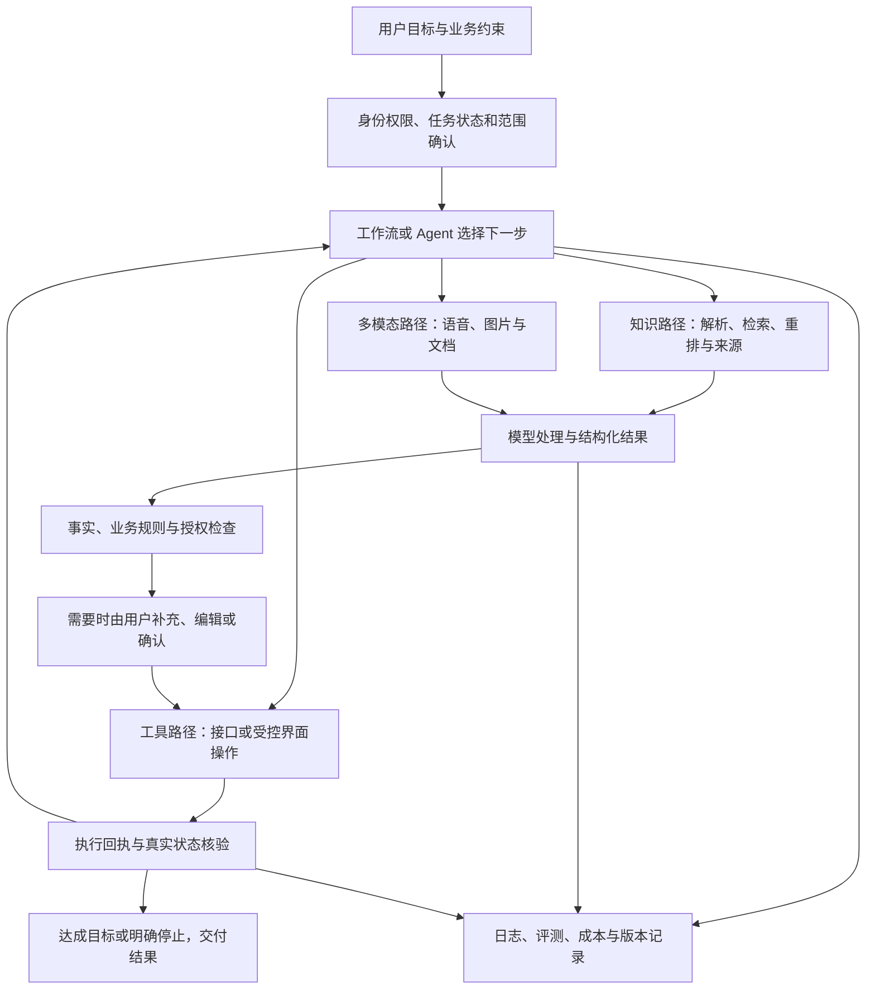

# extra0

## 配套阅读正文

<!-- field:extra/extra0 -->
## 七、把 36 个知识点连成一张任务图

下面是一种通用组织方式，用来理解知识之间的联系，不代表任何具体平台的实际部署架构。

面试时可以这样口述这张图：

“用户提出目标后，我先确认身份、范围和关键条件，再决定哪些步骤固定走工作流、哪些交给 Agent 判断。要资料就走解析检索，要实际操作就调工具。模型负责理解和生成，程序负责权限、计算和业务状态校验。关键节点请用户补充或确认，最后用真实执行结果判断任务完成。全程保留必要记录，便于评测、排错和算成本。”
<!-- /field -->
