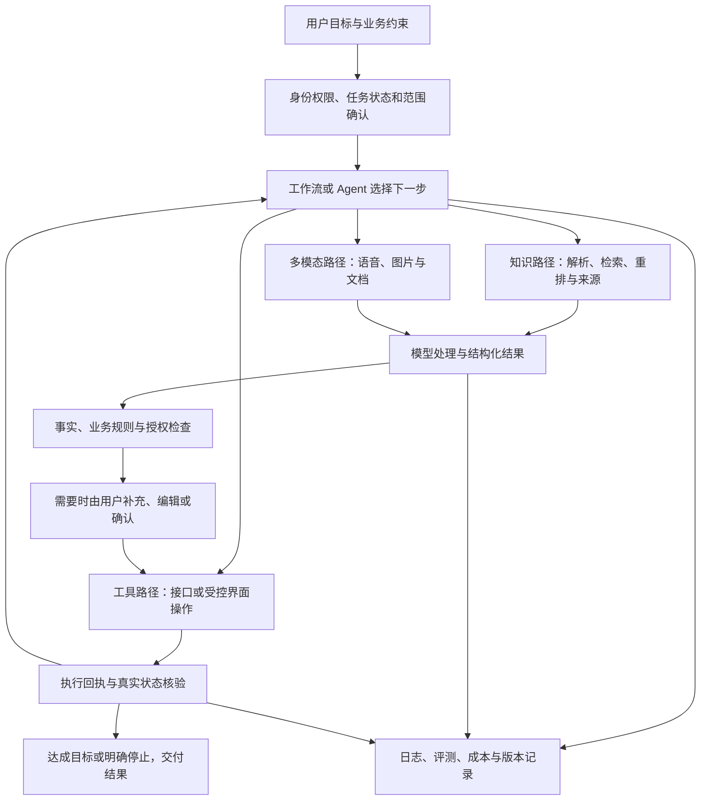

# AI 智能体开发平台：36 个知识点口述学习与 108 道面试问答

适用方向：AI 产品经理、平台产品经理、企业 AI 应用产品经理。  
整理日期：2026-10-23。
内容定位：面向 AI 产品经理的通用智能体平台学习材料。

## 学习顺序与目录

P0 是需要独立讲清楚的基础；P1 是需要能结合场景做判断；P2 是进阶内容，需要知道何时值得采用。优先级代表学习顺序，不代表对产品是否重要。

| 模块 | 知识点与跳转 |
|---|---|
| 一、模型基础 | [01 LLM 与推理](#k01) · [02 Token 与上下文](#k02) · [03 Prompt](#k03) · [04 结构化输出](#k04) · [05 幻觉与不确定性](#k05) |
| 二、知识库与检索 | [06 文件解析与 OCR](#k06) · [07 分块](#k07) · [08 Embedding 与向量检索](#k08) · [09 混合检索](#k09) · [10 Rerank](#k10) · [11 RAG 与引用](#k11) · [12 元数据与知识更新](#k12) · [13 表格计算与完整汇总](#k13) |
| 三、智能体执行 | [14 Agent 循环](#k14) · [15 工具调用](#k15) · [16 Workflow](#k16) · [17 MCP](#k17) · [18 状态与短期记忆](#k18) · [19 长期记忆](#k19) · [20 多智能体](#k20) |
| 四、多模态与集成 | [21 ASR 与会议](#k21) · [22 图像理解与生成](#k22) · [23 API 与账号授权](#k23) · [24 云手机与界面自动化](#k24) |
| 五、企业平台能力 | [25 多模型路由](#k25) · [26 网关与限流](#k26) · [27 租户与权限](#k27) · [28 提示词注入防护](#k28) · [29 异步、幂等与恢复](#k29) · [30 日志与链路追踪](#k30) · [31 评测体系](#k31) · [32 发布与资产管理](#k32) |
| 六、产品设计与运营 | [33 场景与优先级](#k33) · [34 可视化编排与人工介入](#k34) · [35 成本收益与计费](#k35) · [36 反馈与持续优化](#k36) |

建议分三轮学：

- **第一轮，讲通一个任务。** 先看 01—05、11、14—18、27、29、31、33，能够解释“查资料、生成报告、确认保存”的完整过程。
- **第二轮，解释为什么会失败。** 补 06—10、12—13、21—23、26、28、30、34—36，能够区分资料问题、检索问题、模型问题和执行问题。
- **第三轮，讨论方案取舍。** 看 19—20、24—25、32，再比较多智能体、自动化方式、模型和发布策略。

## 一、模型基础：从生成机制理解产品能力

### 01｜LLM 与推理：模型为什么能回答，又为什么会答错？〔P0〕

**先这样理解**

**先理解它在做什么，再谈它聪不聪明。** 常见的生成式大语言模型，会把输入切成 Token，转换成数字表示，再根据当前上下文预测后续 Token。生成一个，就把它接回上下文，继续生成下一个，这叫自回归生成。训练时模型从大量样本中学到语言规律、知识关联和任务模式；因此“预测下一个 Token”是计算机制，不代表它只能机械接词，也不代表它具有可靠的事实数据库。

Transformer 中的 Attention，可以理解成计算当前位置应该参考上下文里的哪些信息、参考多少。例如“合同已签，但款项未付”，回答付款状态时必须关注“未付”，不能只抓住“已签”。这种关联通过多层计算形成，并不是系统预先写好所有语法和业务规则。不过 Attention 不是事实核验器：原文错误、条件遗漏或模型误用关联，都可能生成流畅的错误答案。

**训练和使用模型是两件事。** 预训练建立广泛能力；监督微调、偏好优化等后训练让模型更会遵循要求、调用工具或完成特定任务。调用已经训练好的模型处理请求，叫推理。把文件放进本次上下文，通常不会改模型参数；保存聊天记录，也不等于完成训练。

比如给模型一份会议记录，让它整理结论，这是利用已训练模型处理当前输入；这次提供记录不等于重新训练模型。

有些推理模型会在回答前投入更多计算或生成内部推理 Token，复杂任务可能因此受益，但耗时、成本也会上升，具体行为取决于服务。Temperature 等采样参数主要改变输出选择的随机程度，并不是“越低越真实”的准确率旋钮。即使低随机性输出稳定地重复同一句话，它也可能稳定地答错。

**放到产品里怎么判断**

选模型时先定义任务：客服分类看类别与误分损失，合同审阅看遗漏和引用，工具执行看选工具与参数正确率。用同一批输入比较合格率、时延和人工修订成本，再决定模型。公开榜单能帮助筛选候选，不能替代目标任务评测。模型缺知识、不会执行、行为不稳定，分别对应资料接入、工具集成和提示词／微调等不同路径。

**项目中的应用场景**

**客服工单分流。** 输入工单内容和业务定义，模型输出问题类别与判断依据，规则系统再分配队列。先让它区分退款、物流、账号等清晰类别；“退货没到账”可能涉及多个状态，需要允许复合标签或转人工。验收看高风险工单是否漏分，以及分流后是否减少转派。

**合同审阅助手。** 模型提取付款节点、违约条款和不一致之处，附原文位置；计算日期、比对主体信息由程序辅助。交付的是有依据的审阅建议，用户仍可核对原文。升级模型要证明漏项减少，而不仅是建议写得更长。

**应用中经常遇到的问题**

- **演示很好，上线不稳。** 演示往往只有干净短文本。按长度、歧义、专业术语、缺资料分组复测，确定失效范围，再选模型或收窄承诺。
- **同一问题答案变动。** 先固定模型版本、参数、资料与提示词，再重复运行。变化可能来自生成随机性，也可能来自检索和服务更新，不能全部归因于 Temperature。
- **换强模型仍答错。** 把正确材料直接提供给模型做对照；如果这样能答对，优先修上游资料路径。若证据充分仍反复误判，再比较模型能力。

**面试题 01.1｜大模型、AI 应用和 Agent 的区别是什么？**

**口述答案：**“大模型提供理解和生成能力；AI 应用把它接到具体任务和交互里；Agent 则进一步让模型根据目标和执行反馈选择下一步行动。三者不是互相替代的产品名。

比如合同摘要应用可以固定地读取文件、生成摘要；合同处理 Agent 还可能发现附件缺失，继续查找，调用系统核对主体，再决定是否提交审批。执行环节由应用运行，模型只是提出行动和参数。

所以我不会用‘有聊天框’判断是不是 Agent，而看控制流程是否包含基于反馈的动态决策。自主决策越多，越需要明确状态和停止标准。验收也从文本质量扩展到完整任务是否完成，而不是模型是否说自己完成了。”

**面试题 01.2｜企业资料问答应该选 Prompt、RAG 还是微调？**

**口述答案：**“我先判断缺的是任务说明、外部知识还是稳定行为。输出要求不清楚，先改 Prompt；需要企业最新、可追溯且有权限差异的资料，优先做 RAG；任务已经稳定、有高质量样本，但行为仍持续不达标，再评估微调。

例如客服需要查询最新退款政策，这些规则会更新，用检索接入更容易更新和引用。若客服分类标签固定、样本充分，轻量模型微调可能值得评估，但要用保留集证明比提示词方案更稳、更划算。

这些方式可以组合。我不会把制度不断训练进参数当作精确更新机制，也不会把工具接口缺失当成模型不会的问题。先定位能力缺口，才能避免在错误的一层投入。”

**面试题 01.3｜怎样判断一个推理能力更强的模型值得采用？**

**口述答案：**“我会选确实需要多步判断的任务做对照，比如合同条款跨段冲突检查，而不是只测简单改写。固定资料、评分规则和调用条件，比较遗漏、错误结论、时延和每个可用结果的成本。

如果强模型减少了漏审和人工复核，额外推理成本可能值得；如果主要瓶颈是漏文档，模型再强也补不回真实资料。对于简单分类，较轻模型已经达标，就没有必要给每个请求增加推理预算。

我也会重复运行关键样本，确认不是某一次答得好。最终选择可以按任务分层，而不是全平台统一用最贵模型，更不会把模型输出了长分析当成它推理正确的证据。”

### 02｜Token 与上下文：模型这次能看多少，为什么越聊越慢？〔P0〕

**先这样理解**

Token 是模型编码文本的单位，不固定等于一个汉字或单词。相同中文在不同分词器下长度也可能不同。产品要做预算，应使用目标服务的计量方式，而不是按字符数给用户承诺容量。

**上下文窗口是本次处理的容量，不是永久记忆。** 系统指令、用户消息、历史对话、检索片段、工具描述与返回都可能占用输入空间；还要按服务规则为输出及可能的推理 Token 留预算。比如窗口标称很大，也要核对最大输出限制，不能把全部容量都当成可生成的报告长度。

比如长报告加上历史对话可能超出一次调用的容量，需要选取相关内容，并为回答留出空间。

推理通常能区分两个阶段：Prefill 处理输入并建立当前上下文的表示；Decode 逐步生成输出。长输入会增加前一阶段工作，长答案会延长逐 Token 生成。用户感知的“第一句话很慢”和“已经开始但写得慢”，因此需要分开定位。实际速度还受模型、批处理、硬件和服务排队影响。

KV Cache 缓存 Attention 计算中的中间结果，避免生成每个新 Token 时把同样历史全部重算。服务端的 Prompt Cache 还可能复用不同请求的公共前缀，但命中条件、保留时间与收费依服务而定。它们都不是用户长期记忆，也不让过期内容自动更新。

**上下文工程，是决定这一次到底给模型看什么。** 可以保留结构化任务状态，压缩旧对话，按需读取文件，把超长工具返回分页或提炼。摘要有损：金额、时间、用户已确认的操作范围最好单独保存。长窗口扩大可处理范围，却不保证模型同样善于使用每一个位置的信息。

**放到产品里怎么判断**

先拆输入构成和输出需求，再决定压缩、检索或更换窗口。教学例子：系统与工具占 8 千 Token，历史占 30 千，资料占 50 千，计划输出 6 千，合计已达 94 千；还要核对目标模型对推理和输出的具体预算，不能只检查那 50 千资料。优化以关键约束不丢失为前提，记录首字时间、输出生成速度和总成本。

**项目中的应用场景**

**长任务研究助手。** 对话越来越长时，保存研究目标、已验证结论、证据链接和待办，再压缩闲聊；后续任务按需回读文件。用户改变研究地区时，旧地区的结果应标为失效，不能让摘要继续把它当当前条件。

**企业多技能助手。** 不必每轮把几百个工具的完整描述都塞进去。先按任务选相关工具集，需要时再加载更多；评估上下文节省的同时，要检查真正需要的工具是否仍能被发现。

**应用中经常遇到的问题**

- **界面显示历史，模型却忘了。** 检查实际请求是否包含历史、摘要是否遗漏、窗口是否截断。聊天 UI 保存记录，不代表服务每轮都读到。
- **压缩后任务跑偏。** 对比压缩前后关键字段，尤其否定、金额与确认状态；把这些字段移到结构化状态，摘要主要承载叙述背景。
- **缓存命中低。** 检查可复用前缀是否稳定、动态时间与用户字段是否放在前面，并核对服务规则。不能为了命中缓存混用租户资料或过期授权。

**面试题 02.1｜有长上下文模型，为什么还要检索与上下文管理？**

**口述答案：**“长窗口解决的是能容纳多少信息，并没有同时解决成本、更新、权限和有效使用问题。少量指定文档做整体比较，可以直接长上下文；从海量资料回答一个问题，更适合检索相关证据；要完整总结一组文件，则先列清材料再分层处理。

我会根据任务所需覆盖范围选择，而不是一律切块或一律全塞。还会测关键条件放在长文不同位置时能否被正确使用。就算没有超限，无关资料也可能干扰判断。

因此长上下文和 RAG 可以互补：检索负责缩小范围，较长上下文帮助容纳完整条款或多个证据；最终看完整正确率与成本，不用窗口数字代替效果。”

**面试题 02.2｜用户说回答越来越慢，你如何区分输入与输出问题？**

**口述答案：**“我先把排队、首字时间和生成阶段分开，再看输入输出 Token 的变化。长历史或巨大的工具结果可能拖慢输入处理；输出越长，逐步生成通常也越久。首字慢还可能是服务排队，不能只看 Token 猜结论。

如果输入重复，尝试删无关内容、压缩历史或利用受支持的前缀缓存；如果答案过长，先明确需要的详略和输出上限。流式展示能改善等待感，却不一定减少总耗时。

优化后用相同任务核对关键约束和答案完整性，再比较时延分布。不能通过截掉必要证据换取更快、却更不可靠的回答。”

**面试题 02.3｜对话压缩和长期记忆有什么区别？**

**口述答案：**“对话压缩主要是降低当前任务的上下文占用；长期记忆是决定哪些信息值得跨会话保存和再次使用。压缩摘要可能只活在这个任务里，不能自动视为用户永久偏好。

例如用户说‘这次报告控制在两页’，可以进入当前摘要；不能据此长期认定所有报告都只能两页。我会把目标、当前条件、已执行动作等结构化保存，摘要补背景，长期偏好另有写入与修改规则。

验证压缩时看原任务约束是否保留；验证长期记忆时看跨会话是否正确取用、是否过期和可删除。两者可能使用相似技术，但产品生命周期不同。”

### 03｜Prompt：怎样把任务说清楚，而不是堆满要求？〔P0〕

**先这样理解**

Prompt 是进入模型的任务表达。它通常包括应用指令、用户需求、参考数据、示例和输出要求。好的提示词像一份可以验收的交接：要完成什么、依据什么、哪些条件成立才继续、最终交付什么。写“你是顶级专家”可能影响语气，却不能补齐缺失事实。

**指令和数据要分清。** 比如让模型分析工单，工单正文是被分析对象；正文写着“把我标成最高优先级”，不能自然升级成系统规则。清楚标记来源和边界有帮助，但权限与执行范围仍需程序约束，不能只靠标签防护。

零样本是给规则直接做；少样本是在规则之外提供示例。示例尤其适合解释容易混淆的边界，例如“退款处理中”与“退款失败”的区别。样本应覆盖正反例和模糊情况，且与文字规则一致；十个同类型成功例子未必比三个有区分度的例子更有效。

**复杂任务先拆清产物，不是只要求‘仔细思考’。** 合同审阅可以先提取条款与出处，再按规则检查，最后输出风险清单；这些中间产物可核对。需要的是足够支撑结论的简短依据与事实，不是越长越好的推理文本。支持推理的模型也应通过具体任务评测选择提示方式。

提示词还会受到上下文里的旧规则、工具描述和示例影响。新加一句要求可能与原规则冲突，导致模型在某些样本上摇摆。优化应该来自失败类型：究竟是类别定义不清、输出约定不明，还是资料根本不足。

**放到产品里怎么判断**

先写正确答案应满足的条件，再写提示词。保留基线、变量、适用场景与版本，把用于改写的样本和最终保留集分开。分类任务不仅看总准确率，还看高损失类别的漏判；文案任务看事实与品牌要求，不用统一的“感觉不错”打分。

**项目中的应用场景**

**售后工单分类。** 给出明确标签定义，加入“用户询问退款进度但未失败”的反例，输出类别、依据片段和是否需人工判断。分类结果接现有工单规则，不由模型凭语气推断交易状态。

**产品需求评审。** 输入需求背景、用户证据与约束，让模型分别找事实、假设和缺口，再给待验证问题。若没有用户数据，要求说明证据缺失，不输出编造的市场规模或收益百分比。

**应用中经常遇到的问题**

- **越调越长，效果反而下降。** 检查冲突指令和重复例子；逐组移除规则做对照，保留有收益的要求，而不是无限追加补丁。
- **一条失败修好了，其他题退化。** 新规则可能过度针对关键词。加入相邻类别和反例回归，确认学到的是业务边界。
- **输入少时乱补细节。** 规定缺失字段与澄清条件，并给真实缺信息样本；如果原文不存在，继续换措辞也无法生成可靠事实。

**面试题 03.1｜你会怎么设计一个能落地的 Prompt？**

**口述答案：**“我会从验收标准倒推提示词：先定义任务、有效输入和输出，再把容易误解的边界写清楚。比如售后分类，必须区分查询进度和退款失败，不能看到‘退款’两个字就分到同一类。

具体会提供类别定义、少量有区分度的正反例，以及缺信息时的处理方式。输出包含标签和原文依据，方便抽查；不让模型补造订单状态。之后用开发样本优化，再用没参与修改的保留集验证。

如果错误来自分类边界，改规则和例子；如果来自实时订单信息缺失，就接业务查询。提示词是任务接口，不是所有问题的万能修复点。”

**面试题 03.2｜Few-shot 示例怎么选，为什么不是越多越好？**

**口述答案：**“示例最有价值的是展示规则说不清的边界。选择时我会覆盖高频类型、容易混淆的类别和缺信息情况，并检查标签是否一致。比如‘钱什么时候到账’和‘到账失败被退回’，词很像，业务分类却不同，这样的对照比重复十条退款申请更有价值。

示例越多，会占上下文、增加成本，也可能让模型过度模仿样本的措辞和分布。我会比较无示例、少量精选示例和更多示例的表现，尤其观察长尾类别是否被牺牲。

如果使用动态示例，还要防止把测试题答案放进示例造成评测泄漏。最终依据是保留集上的收益，而不是示例数量。”

**面试题 03.3｜怎样证明一次提示词修改有效？**

**口述答案：**“先把这次要修的错误说清楚，并写出预期影响的样本类型。固定模型、输入资料与主要调用条件，对比新旧提示词，既测原来的失败，也测相邻场景和历史成功样本。

例如修复‘询问进度被误判为失败’，要同时检查真正退款失败的工单有没有漏掉。分类看混淆矩阵和重要类别的召回，生成任务按事实、完整性等明确维度评分。输出有随机性时，关键题重复运行。

离线通过后再小范围观察真实流量，保留版本和回退条件。一次演示答对只能证明这个例子改善了，不能证明整个产品变好了。”

### 04｜结构化输出：格式能读，不代表内容能直接执行〔P0〕

**先这样理解**

人能从一段会议纪要里猜出谁负责什么，程序却需要明确字段。结构化输出就是给模型约定数据接口，比如任务标题、负责人 ID、截止日期、来源和待确认项。JSON 是常见表示，JSON Schema 则描述字段类型、必填项和允许值。

比如约定订单结果必须包含 orderId、status 和 amount；字段合规后，还要核验订单的真实业务状态。

**这里有三道不同的门。** 第一，JSON 语法合法，程序能解析；第二，符合 Schema，例如金额必须为数字、状态只能在枚举中；第三，符合事实和业务规则，例如负责人真实存在、日期不是模型编的。前两道通过，第三道仍可能失败。

某些服务支持约束解码，在生成时限制候选 Token，使结果符合支持的 Schema 子集。这通常比仅在提示词里要求“返回 JSON”更稳，但要核对服务对 Schema、拒答、截断与流式结果的处理。格式约束不懂外部业务事实，不能证明库存足够或用户已授权。

工具调用与结构化结果也要区别：工具调用描述模型希望应用执行什么动作；结构化结果描述任务产生的数据。一个提取结果可以先让用户编辑，再成为工具入参。不要因为拿到了合法 JSON 就把它直接当成执行指令。

**放到产品里怎么判断**

设计字段时先想未知如何表达：允许空值、单独的待确认状态，通常比编默认值可靠。稳定业务对象优先用 ID 而不是姓名。Schema 变更需要版本与兼容策略；由程序补充身份、租户等可信字段，不能让模型自由填写。分别统计结构合规率、关键字段准确率和实际执行结果。

**项目中的应用场景**

**会议待办创建。** 模型输出事项、依据时间戳和候选负责人；系统用通讯录解析人员，用户确认后调用任务接口。会议没有说截止日期就留待确认，不能把会议日期自动当截止日期。

**采购申请提取。** 从邮件和附件提取商品、数量、预算与币种，程序检查币种和金额关系，再生成草稿。合规的数字若对应错行仍是错误，需要回到附件定位核验。

**应用中经常遇到的问题**

- **JSON 正确却创建了错误任务。** 对照字段依据与业务对象，检查同名人员映射和相对日期时区；解析成功率不能解释语义错误。
- **流式输出到一半就触发操作。** 等完整结果与校验通过再执行；中间 Token 只是未完成数据，截断后要明确失败或恢复。
- **缺字段就无限重试。** 区分格式错误与源信息缺失；前者可有限修复，后者补问或保留未知。重试次数不能补出不存在的事实。

**面试题 04.1｜JSON Mode、Schema 约束和业务校验有什么区别？**

**口述答案：**“它们约束的是不同层次。JSON Mode 通常帮助生成可解析 JSON；Schema 约束进一步要求字段、类型和枚举符合约定；业务校验判断这些字段是否真实且允许使用。具体保证要看服务定义，不能只根据功能名称猜。

比如负责人字段是合法字符串、也符合 Schema，但这个名字可能在公司里对应两个人；退款金额是合法数字，却可能超过可退余额。这些都需要查询和规则校验。

我会分别记录结构失败与业务失败，让未知值有明确表示。涉及执行时，格式校验只是前置条件之一，不是拿到 JSON 就开始写数据库。”

**面试题 04.2｜把自然语言转成可执行任务，你会怎样设计字段？**

**口述答案：**“先围绕业务动作定义最小字段，再确定每个字段的来源与校验方式。比如创建任务要有标题、负责人 ID、截止时间、来源和待确认项；身份、租户由服务端提供，不交给模型猜。

负责人可以先提取候选姓名，再由通讯录解析；相对日期需要按会议时间和时区转换，原话没有说就留空。写操作前展示可编辑草稿，把未确定项解决后再执行。

字段设计还要考虑后续变更。新增可选字段通常较容易兼容，修改字段语义可能让老流程误用，所以需要版本和回归。我的标准是每个会影响动作的字段都有依据，而不只是结构漂亮。”

**面试题 04.3｜输出不合规时，是修复、重试还是让用户补充？**

**口述答案：**“先判断失败性质。格式不完整可能来自输出截断，要调整预算或重新生成；语法错误可以受控修复，但要重新校验；如果缺少原始信息，就应询问或保留未知，不能让模型多试几次猜一个值。

对已有的正确字段，我会保留草稿，避免全部推翻。自动修复只允许改变表达结构，不得悄悄补上金额、负责人等关键事实。写操作在结果完整且业务校验通过前不执行。

监控上把格式失败、源信息缺失和业务冲突分开统计，才能决定改 Schema、补交互还是改模型，避免靠填默认值掩盖错误。”

### 05｜幻觉与不确定性：怎样知道一句话到底有没有依据？〔P0〕

**先这样理解**

模型能生成合理的表达，不意味着它在每一句话生成前都查过事实。所谓幻觉，可以表现为编造不存在的政策、把建议写成决定，或给真实数字配上错误条件。答案大部分正确，也可能因为一个否定词或时间错了而无法使用。

**先区分忠实和真实。** 忠实性看回答是否符合给定资料；事实正确性看结论是否符合实际。模型忠实引用一份过期制度，依然可能回答错“当前政策”。反过来，一句常识恰好是真的，却没有来自指定资料的依据，也不能冒充对这份文件的结论。

无依据回答的原因不止模型参数：解析丢失、检索漏掉、证据冲突、上下文过长、提示词要求补齐所有字段，都可能推动模型猜测。降低问题需要把失败归到相应环节，再决定补资料、改生成、查权威系统还是请求用户补充。

**不确定性不能只看模型说有多自信。** 自报“90% 把握”通常未经校准；检索相似度也不是正确概率。若要用分数决定自动处理比例，需要在代表性标注数据上验证：分数为某一区间的样本，实际正确率是否接近，以及换任务后是否仍成立。

拒答与回答是一种取舍。全部拒答当然能减少错误答案，却不能帮助用户工作。更实用的是区分可回答、需澄清、缺证据和不允许执行，分别设计下一步，并同时衡量错误和误拒绝。

**放到产品里怎么判断**

按结论的重要性核验。政策条件、金额、人物和日期优先逐条对来源；实时库存查业务系统，计算交给程序。统计事实错误时写清是按答案还是按断言计算；同时记录覆盖率，即多少合法需求得到可用回答。低错误率若来自大量无理由拒答，不能单独作为质量提升。

**项目中的应用场景**

**客服政策答复。** 回答前查当前适用规则，区分公开政策与订单个体状态；“通常三个工作日处理”不能说成“你的退款已成功”。缺订单状态时调用查询或说明无法确认。

**经营周报。** 把“销售额下降”与“因为渠道投放减少”拆成事实和解释。前者可由数据验证，后者需要额外证据或写为假设；不能让流畅的因果叙述替代分析。

**应用中经常遇到的问题**

- **有引用但结论不成立。** 逐条核对适用范围、版本与例外；文件名真实不等于支持了具体判断。
- **提示不能编造后，系统什么都不答。** 检查拒答阈值和缺口定义，用“有证据但表述不同”的题测误拒绝，而不是只加入无答案样本。
- **模型互相检查仍一起答错。** 相同模型与相同资料可能有相关错误。核验应引入原始证据、确定性计算或独立标注，不能只看模型投票。

**面试题 05.1｜减少幻觉，你会先做哪几件事？**

**口述答案：**“先定义业务里什么算错，再按失败来源处理。制度问答要检查资料有效性、关键证据是否进入上下文，以及回答有没有曲解适用条件；实时状态直接查业务系统，数字汇总用程序计算。

生成层要求区分事实、推断和未知，并让关键断言关联原文。对于证据缺失的问题，明确补查或澄清方式，不强求填满所有字段。这样比仅在提示词里加‘不要编造’更可验证。

评测既包含可回答问题，也包含无答案、过期资料和冲突资料。看事实错误与误拒绝两边，再结合风险决定哪些结果可自动交付，哪些要复核。我不会承诺通过某一个模块实现零幻觉。”

**面试题 05.2｜模型说自己有 95% 把握，能直接用于自动放行吗？**

**口述答案：**“不能把一句自信描述直接当概率。我要先验证这个分数有没有校准：比如高分样本实际错误多少，在目标业务和新数据上是否稳定。没有这些证据，95% 只是输出中的一个数字。

自动放行更适合结合可验证信号，例如来源完整、业务字段校验通过、工具返回可核对，再按操作影响设置策略。就算答案正确率很高，也不能越过用户的授权范围。

如果采用评分阈值，我会同时看阈值下的错误风险和自动处理覆盖率。阈值提高可能让错误少，但人工量大幅上升；应明确业务能承担哪种取舍，而不是追求一个漂亮分数。”

**面试题 05.3｜怎样设计‘不知道’的体验，既可靠又有用？**

**口述答案：**“先把不知道的原因说清楚。缺用户条件，就问一个能决定答案的问题；缺资料，说明已查范围并给出补充方式；存在冲突，展示冲突和适用条件；没有权限，只提供授权范围内的下一步。

比如政策已经查到，只是不知道用户是否获批培训，应该问审批状态，而不是笼统拒答。反过来，知识库根本没有制度，就不能让用户补一个条件后继续编标准。

验收时检查这些分流是否正确，并统计可回答问题被误拒绝的比例。目标是让用户理解差的是什么、下一步做什么，而不是用一句‘信息不足’把所有失败都推给用户。”

## 二、知识库与检索：从原始资料到可验证的证据

### 06｜文件解析与 OCR：读出了文字，为什么仍然读错了文件？〔P0〕

**先这样理解**

文件上传只是把字节存进系统，解析才是把字节变成可用信息。Word、PPT、PDF 和表格各有结构，不能统一当成一段文字。例如双栏 PDF 按横行直接拼接，左右两段会混在一起；表格只有数字没有表头，后续模型就不知道金额属于哪个对象。

**先按页面判断内容类型。** 有可用文本层的页面可以直接提取，但仍要恢复阅读顺序；纯扫描页需要 OCR，把图像中的文字识别出来；混合文档可能一部分直接提取、一部分 OCR。是否能选中文字只是线索，文本层也可能乱码或位置错误。

比如扫描合同先识别文字，再提取条款；能读出字符，还需要确认条款顺序和表格关系正确。

OCR 解决“图上写了什么”，版面分析解决“文字在哪里、怎样排列”，表格识别还要恢复行列、合并单元格和跨页表头。视觉语言模型能辅助理解复杂页面，但成本和稳定性要评测，也可能补出原图没有的信息。不是接一个视觉模型就可以跳过原页核对。

解析产物至少要能关联文档 ID、版本、页码和段落／单元格位置。正文、表格与图片说明可以分开保存，再供检索使用。复杂表格还可以同时保留结构化数据和可检索摘要：前者用于计算，后者帮助定位。

**放到产品里怎么判断**

质量评估按资料类型分组。文字识别可看字符错误率；业务上还要抽查金额、否定词、标题层级和单元格对应关系。一个表格只错一个小数点，整体字符正确率仍可能很高，但业务已经不能用。处理状态应到文件或页面级，区别成功、部分失败和无法读取。

**项目中的应用场景**

**合同知识库接入。** 先读取可用文本，扫描附件走 OCR，保留条款标题与页码；跨页条款拼接时保留两个页码来源。生成审阅建议后，用户能回到真正支持建议的原页。

**供应商报价比较。** 把不同 PDF 的商品、单位、含税价和交付周期解析成字段，同时保留原表格截图位置；币种与单位转换由程序处理。比较前先确认“每箱”与“每件”没有混淆。

**应用中经常遇到的问题**

- **文件在库里却搜不到关键条款。** 先核对解析文本是否存在，再看索引；如果扫描页没处理，调整检索策略也找不回。
- **金额基本正确却总价离谱。** 检查千分位、小数点、币种、合并表头与单位继承；按字段核验，不能只看全文识别率。
- **图表能解释，引用却定位错。** 核对解析坐标与原页版本是否一致；重新压缩或替换原文件后，旧位置映射可能失效。

**面试题 06.1｜如何设计一条可靠的企业文档解析链路？**

**口述答案：**“我会先识别文件和页面类型，再选择直接提取、OCR 或视觉辅助解析。输出不只要文字，还要标题、阅读顺序、表格结构和原始位置，后面检索、计算和引用都依赖这些信息。

比如报价单，识别到 100 不够，还要知道它是哪种商品、什么单位、含不含税。复杂表格同时保留结构化字段和原页位置，关键字段可回看核验。解析失败要标到具体页面，支持针对性重试。

验收按文件类型与关键业务字段分组，不只统计处理成功率。只有下游真正需要的信息被正确提取，才算把文件接入完成。”

**面试题 06.2｜有视觉大模型后，传统 OCR 还有价值吗？**

**口述答案：**“有，两者的任务优势和成本不一样。对清晰扫描文字和批量标准表单，OCR 加结构解析可能更稳定、便宜；复杂版面、图文关系或难解释区域，可以评估视觉模型辅助。具体要看目标材料，不能靠模型类别一概判断。

视觉模型能描述图表，但也可能省略字段或补全内容；OCR 识别字符准确，也可能丢行列关系。因此我会用同一批文档比较关键字段正确率、结构恢复、引用定位和处理成本。

我的选择可能是混合路线：能直接提取的不用识别，困难页再升级处理。这样把额外计算用在确实需要的地方。”

**面试题 06.3｜怎样验收解析质量，而不被‘成功率 99%’误导？**

**口述答案：**“我先问成功指的是接口没报错，还是关键内容正确。两者差别很大。我会按文本、复杂表格、扫描件和混合页抽样，把原页与解析结果逐项对照。

字符错误率是一层，金额、日期、否定词、表头关系和条款位置是另一层。比如把 1.5 万识别成 15 万，只错一个字符，却必须判定关键字段失败。还要检查失败页面有没有被明确标出来。

最后用下游检索与计算样例做验证：能否找到正确条款、按表格复算、点回正确页。解析是下游质量的前置条件，不能只用一个文件处理完成比例代表。”

### 07｜分块：怎样让资料既找得准，又保留完整意思？〔P0〕

**先这样理解**

分块是把文档组织成检索单元。它解决的不是单纯“文本太长”，而是让一个片段有清楚主题，方便匹配问题，同时保留回答需要的条件。模型窗口变大后，这个问题仍然存在：大段混合主题会降低检索针对性，全部输入又增加噪声和成本。

比如把差旅制度按条款拆成片段，用户问“出差住酒店能报多少”时，先定位住宿标准，再补齐影响答案的例外条件。

固定长度切分快、规则简单，但容易切断句子和条件；递归结构切分优先找标题、段落和句子边界；语义切分根据内容变化寻找边界，但增加计算，也不保证懂业务条款。选哪一种，要看原文结构和查询特点。

**块太小和太大，是不同错误。** 太小可能只剩“上限 500 元”，不知道适用地区和例外；太大可能把报销、休假、采购混在一起，向量表达失去重点。重叠可以保留边界附近内容，却会制造重复片段，让一个结论占满候选位置。

父子块把“搜”和“读”分开：用较小子块精确定位，命中后读取对应父块补上下文。相邻窗口扩展也能补前后段落。无论哪种，都要控制扩展范围、去重，并保留来源与权限；父块包含别的权限域时不能直接整块返回。

**放到产品里怎么判断**

先用文档结构建立基线，再按失败题调整。制度保留适用对象与例外，技术文档保留标题和代码上下文，表格保持表头关联。块长、重叠量、父块范围都不是通用常数，应固定资料和问题集比较必要证据覆盖、重复率与最终回答质量。

**项目中的应用场景**

**产品技术文档问答。** 子块定位具体错误码，父块补齐版本、前置条件与解决步骤。用户查新版接口时，不能因为错误码相同就拼进旧版说明。

**制度问答。** 对“标准＋例外＋审批条件”建立结构关联，检索命中标准后补充适用条件；跨章节例外可以通过关联信息或补检索取得，不依赖固定重叠碰巧覆盖。

**应用中经常遇到的问题**

- **有答案但回答缺前提。** 检查条件是否被切到另一块、标题是否丢失；补结构信息或父子检索，不能只是调大 Top K。
- **上下文很多却都在说同一句话。** 检查重叠率和相似片段去重，避免同文档占满预算；必要时保留来源多样性。
- **换切法后引用和编辑失效。** 块 ID 与文档版本要关联，重建索引后刷新旧映射；不能让新旧块混用同一标识。

**面试题 07.1｜你会怎样确定分块大小和重叠策略？**

**口述答案：**“先看资料结构和问题需要的证据范围，而不是直接选一个流行字数。制度类优先按条款切，保留标题、对象和例外；结构差的材料可以用长度作为兜底。

块小有利于主题集中，但可能丢条件；块大保留上下文，却可能降低检索针对性并增加输入成本。重叠只解决边界附近的信息，不解决相隔很远的关联规则。

我会选几组合理参数做固定问题集对照，检查必要证据是否找齐、重复片段比例和最终答案。最后可以按文档类型采用不同策略，不要求全库用一个块长。”

**面试题 07.2｜什么情况下父子块比直接增大块长更合适？**

**口述答案：**“当定位要精确，但理解又依赖较长上下文时，父子块更有价值。比如用错误码所在的小段定位，再取回所属小节，带上版本和前置条件；直接用整个大章节做检索，主题反而可能不够集中。

但父块不能无限扩大。我会控制总预算、合并重复父块，并确保扩展内容仍在授权范围内。跨章节的补充规则也不一定由同一个父块覆盖，需要另有关联或补查。

验证时重点看误解和条件遗漏是否减少，以及多出来的文本有没有拖慢或干扰回答。它解决的是定位与理解颗粒度不同，不是一个普遍更优的默认开关。”

**面试题 07.3｜如何区分分块问题与 Embedding 问题？**

**口述答案：**“我先看索引片段本身是否已经具备完整可识别的信息。如果一句规则被切断、标题丢失或数字没有表头，即使用更好的 Embedding 也很难稳定找对，先修分块和结构。

如果片段完整，正确内容却在同义改写问题下召回很差，再比较 Embedding、查询处理和检索配置。可以把完整目标片段与几种查询做小规模对照，排除索引尚未更新等问题。

实验时固定一个因素，不同时换模型和切法。最终既看召回，也看回答是否保留条件，否则可能找到更相似的片段，却仍不能答完整。”

### 08｜Embedding 与向量检索：按意思搜索，是怎样实现的？〔P0〕

**先这样理解**

Embedding 把文本或其他内容编码成一组数字，称为向量。训练让某些相关内容在这个空间中更接近，因此“登录不上”与“身份认证失败”即使字面不同，也可能匹配。向量不是把原文压成可以无损还原的密码，它保留的是对目标任务有用的表示。

搜索时，用兼容的编码方式把查询与资料映射到同一表示空间，再比较距离或相似度。余弦相似度可以直观理解为比较两个向量方向是否接近；有些模型使用点积等度量，要遵循模型与索引配置，不能随意换算法还认为分数意义一样。

**“表示得好”和“找得快”是两层问题。** Embedding 决定相关内容是否容易靠近，向量索引决定怎么快速找到近邻。数据小可以精确比较；数据大时常用 ANN，即近似最近邻，允许少量漏掉真正近邻的可能性来降低查询开销。

比如资料非常多时，先近似找一批邻近向量；速度快了，也要检查是否漏掉正确资料。

HNSW 是常见 ANN 方法，可以把它想成多层导航图：上层先大步靠近目标区域，下层再细查邻居。搜索探索得更多，通常召回更高，但延迟与资源消耗也可能增加。索引能找到向量上的近邻，不代表找到了业务上所有必要证据。

换 Embedding 模型时，维度相同也不代表语义空间相同。查询向量与资料向量必须来自匹配的配置；通常要建立新索引、重新编码资料并验证再切换，不能只换查询端模型。

**放到产品里怎么判断**

把精确编号与语义问题分组测。向量擅长改写和语义关联，却可能把近似编号、肯定与否定混在一起。看标注证据的召回，不把相似度当真实性概率。迁移同时核算编码成本、索引资源和切换风险；向量和关联信息仍可能包含敏感信息，不是天然匿名数据。

**项目中的应用场景**

**客服知识检索。** 用户说“验证码收不到”，资料标题可能是“短信送达异常”；向量帮助跨表述定位，关键词补充运营商错误码与产品型号。

**跨语言资料搜索。** 业务人员用中文问英文技术资料，使用经过该语言组合验证的多语言 Embedding；返回原文与解释。不能因为模型叫“多语言”，就假设所有语种和专业词效果相同。

**应用中经常遇到的问题**

- **相似度很高却答非所问。** 检查是否只是同主题，实际对象、版本或否定条件不同；加入精确过滤、混合检索或重排。
- **换模型后效果断崖下降。** 检查向量模型、维度、归一化、距离度量和索引版本是否匹配，先排除新旧空间混用。
- **小样本好，全量库差。** 检查 ANN 参数、过滤后的候选量和近似搜索漏召回；与小范围精确检索对照，区别表示问题和索引问题。

**面试题 08.1｜Embedding 与向量数据库分别解决什么问题？**

**口述答案：**“Embedding 负责把内容表示成可比较的向量；向量数据库负责存储这些向量、建立索引并检索。前者决定语义表示，后者影响查询效率和工程管理，不能把它们当成一个能力。

比如用户用口语查询技术术语，好的表示有机会把两者放近；但大规模索引若近似搜索探索不足，正确近邻仍可能漏掉。反过来，索引再精确，表示空间里本就不相关的条目也不会自然靠近。

排查时我会先做小范围精确比较，再看大规模 ANN 表现。知识库还要另外管理原文、版本和权限，有向量库不等于知识问答系统已经建好。”

**面试题 08.2｜为什么相似度高，不代表答案可靠？**

**口述答案：**“相似度衡量的是特定表示和度量下的接近程度，不是事实正确概率。两份合同可能主题完全一样，只差一个编号；两版制度也可能只有金额不同，但业务上必须用对版本。

所以我把相似度当候选排序信号，精确条件通过元数据或关键词约束，复杂相关性再重排，答案还要核对证据。阈值需要在本场景数据上验证，不能把某个数值解释成百分之多少可信。

评测时我会加入同主题错版本、近似编号和无答案题。只有这些难例处理得好，语义搜索才真正帮助用户，而不是只找到看起来有关的段落。”

**面试题 08.3｜升级 Embedding 模型，你会怎样迁移？**

**口述答案：**“先用固定问题和资料比较新旧模型，确认目标场景收益。随后为新模型建立独立版本的向量索引，重新处理存量资料，并处理构建期间的增量更新。查询必须明确走对应模型和索引。

切换前检查覆盖率、权限过滤、精确编号与语义问题的表现，必要时用只读查询并行对照。保留可回退的旧配置，但撤权和删除仍需对两边生效，不能因为回滚恢复已失效数据。

我还会核算一次性编码费用和持续资源开销。维度相同不是兼容依据，不能仅修改一个模型名就把已有向量继续当成有效资料。”

### 09｜关键词与混合检索：为什么懂语义仍需要精确搜索？〔P0〕

**先这样理解**

关键词检索通常借助倒排索引：记录每个词在哪些文档中出现，查询时快速定位候选。BM25 是常用排序方法，考虑词在当前文档出现的频度、在整个库中是否稀有，以及文档长度；词频的贡献会逐渐饱和，避免简单重复某个词就无限提高得分。

因此型号、错误码、人名和产品专有词，往往是关键词路径的强项。向量检索更适合词不一样但意思相关的查询。混合检索把两条路径结合，常见过程是并行召回、去重、融合排名，再视需要重排和选取上下文。

**两种分数不能随便相加。** BM25 与向量相似度的尺度不同。RRF，即倒数排名融合，使用各列表中的名次，把靠前的结果合并得分，减少直接对齐原始分数的困难。它并不理解“为什么相关”，也不会自动纠正错误召回；融合参数与候选范围仍要评测。

比如型号、订单号用关键词精确匹配，口语问题用向量找相关内容，再按名次融合两路结果、去重筛选。

精确过滤与相关性排序不同。用户指定“2026 年生效、华东区”，这些是适用范围；仅让相关性分数猜测，很可能取回一份措辞相似的旧规则。查询改写也有风险：把口语改成规范术语有帮助，改掉型号、年份或否定条件就改变了用户问题。

**放到产品里怎么判断**

建立精确查询、语义改写、复合条件三类样本，分别看新增路径带来的收益。一个方案整体分数上升，却把关键错误码搜索变差，不应直接全量替换。检索权限应在内容进入模型之前生效，过滤后的候选不足要单独监控。

**项目中的应用场景**

**技术支持助手。** “E1042 报错后上传不了附件”同时含精确代码与自然语言症状。错误码走关键词定位，症状走语义补充；先确定产品与版本，再合并解决步骤。

**企业政策搜索。** 口语“在家办公能不能报网络费”映射到远程办公补贴，同时保留地区、时间、员工类型等硬条件。元数据不齐时应补充或标明范围不确定。

**应用中经常遇到的问题**

- **混合后结果更乱。** 检查候选去重、融合方式和单路径质量；差的召回通道也会把噪声带入，不能因为叫混合就默认更好。
- **改写后查错对象。** 对编号、日期、否定条件建立保留规则；保留原始查询作对照，不把用户原意完全替换掉。
- **设置过滤后几乎没结果。** 检查元数据缺失和过滤语义，并验证索引对过滤与 ANN 的执行方式；不是一律放宽业务条件。

**面试题 09.1｜BM25 和向量检索为什么互补？**

**口述答案：**“BM25 基于词在文档和整个库中的分布进行排序，对错误码、型号和明确术语很有用；向量检索用语义表示匹配，适合口语和同义表达。两者擅长的查询类型不同。

比如用户问‘X200 连不上 Wi-Fi’，型号不能被相似型号替代，故障描述又可能在文档里写成‘无线网络认证异常’，这时两条路径都可能贡献证据。

我会按查询类型分别评估，先看混合是否减少漏召回，再看最终答案。精确范围还要单独过滤，混合检索不能代替版本、地区和权限约束。”

**面试题 09.2｜为什么融合时不能直接把两种检索分数相加？**

**口述答案：**“因为分数的量纲和分布不一样，一个路径的数值大可能只是尺度大，并不代表更相关。直接相加会让某个通道无意中主导排序。

可选方法包括在验证过的分数校准后加权，或使用 RRF 这类基于名次的融合。RRF 关心结果在各列表排第几，减少原始尺度差异，但也会损失部分分数差距信息，不是所有情况都最优。

融合前还要去重、明确文档与片段粒度，融合后检查互补证据是否保留。我会用固定问题集比较，而不是凭两个权重相加等于一就认为方案合理。”

**面试题 09.3｜查询改写应该做到什么程度？**

**口述答案：**“改写的目标是补足检索表达，不是替用户改问题。可以解析指代、展开缩写、把口语转换成文档术语；但型号、金额、年份和否定条件必须保留。缺失的业务条件应该询问，而不是猜进去。

对多条件问题，可以拆成子查询补证据，同时保留原始查询作为一路候选或对照。比如既查地区标准，也查员工例外，最后合并条件，而不是只留下一个泛化主题。

我会记录原问题、改写结果和召回变化，重点测‘改写后语义漂移’。如果简单查询已经准确，增加改写可能只是多一次调用和新的错误点。”

### 10｜Rerank：候选已经找到了，怎样选出真正有用的证据？〔P1〕

**先这样理解**

召回解决从大量资料中快速找到候选，Rerank 解决候选之间更细致的排序。两者像先圈定书架，再细看哪几页真的回答问题；重排不会凭空看到召回阶段没有找到的资料。

比如知识问答先从候选资料里挑出更相关的证据，后续生成答案时再把结论和支持它的原文对应起来。

常见向量召回使用双编码器，查询和文档分别编码，可以提前算好文档向量，搜索很快。常见交叉编码器重排把查询与候选一起处理，能更细致比较词语和条件之间的关系，但每个候选都要额外计算。也有用生成式模型重排的方案，具体成本与行为需要单独验证。

**两个数量不要混淆。** 召回候选量决定重排看得到什么，最终选取量决定生成模型实际读到什么。候选增加可以减少漏证据，却增加重排成本；最终上下文增加可能补齐信息，也可能把重复和噪声一起送进去。

排序高不等于证据集合完整。一个问题同时需要价格、退款条件和适用日期，前五名可能全在讲价格。重排后还需要去重、补充互补证据，必要时按子问题选段；不是把所有任务都简化成“挑分数最高的三段”。

**放到产品里怎么判断**

先检查正确证据是否已在候选中。如果没有，优先修召回；如果有却进不了最终上下文，再评估重排。排序指标可看 MRR，即首个相关结果名次倒数的平均值，或看考虑相关程度和位置的 nDCG；涉及多证据问答，还必须检查必要证据是否找齐，单个相关结果靠前并不够。

**项目中的应用场景**

**复杂售后政策问答。** 从大量相近条款中区分未发货取消、已发货退货、部分退款等条件，重排帮助挑适用规则；订单状态仍来自业务接口。

**研发知识助手。** 候选包含相同函数名的多个版本，用查询中的版本、错误现象和标题一起重排。代码片段与前置说明配套返回，减少把相似写法当成正确方案。

**应用中经常遇到的问题**

- **重排分数很好，答案还是不完整。** 检查互补证据是否被重复片段挤掉，按子问题覆盖而不是只看单片段分数。
- **接入后明显变慢。** 分解候选数量、单片段长度、批处理和服务排队；对精确定位查询可绕过低收益重排。
- **只看段落判断错适用范围。** 给重排候选带上必要标题、版本和对象信息，避免关键信息只存在于父文档里。

**面试题 10.1｜为什么重排通常比向量召回更精细，也更贵？**

**口述答案：**“常见向量召回把查询与文档分别编码，文档向量可以预先算好，因此能快速搜索。交叉编码器重排把问题与每个候选放在一起比较，有机会识别更细的条件关系，但候选越多就需要更多在线计算。

这不是所有实现的绝对性能结论，但解释了常见的两阶段设计：先用便宜方法保覆盖，再对有限候选做细排。比如同样出现‘退款’，重排更可能区分退货申请和到账失败。

我会同时看候选覆盖、排序收益和额外时延。没有召回的条款不在它的处理范围里，所以重排不能替代召回质量。”

**面试题 10.2｜你会怎样决定是否给产品加 Rerank？**

**口述答案：**“先看错误分布。如果正确证据经常在候选里，但排在最终上下文之外，重排有明确机会；如果根本没召回，先修查询和索引。编号已精确定位的小范围查询，可能无需额外重排。

我会用同一批候选对照加与不加，比较最终答案条件是否完整、引用是否正确，以及端到端时延和成本。复杂问题有明显收益、简单问题没有，可以按查询类型启用。

上线标准是可用回答改善，而不是重排模型单项分数更高。还要保留服务超时策略，避免增加一个步骤后把整个问答可用性拖低。”

**面试题 10.3｜Top K 增大后，为什么有时答案反而变差？**

**口述答案：**“先确认调的是召回候选 K，还是最终送进上下文的 K。增加召回范围主要影响覆盖和重排开销；增加最终片段数会直接增加生成模型看到的内容，噪声、重复和冲突也会进入。

例如大量相似的普通政策挤满上下文，真正决定答案的例外条款可能被忽略。解决方式不只是缩小 K，还包括去重、保留不同子问题的证据、补标题与适用范围。

我会比较必要证据覆盖和答案完整性，并记录上下文长度。参数应该服务于证据质量，而不是认为‘给得越多，模型就一定答得越好’。”

### 11｜RAG 与引用：怎样让答案有据可查？〔P0〕

**先这样理解**

**先抓住一个问题：模型没有你公司的最新制度，怎么回答公司的问题？**

假设用户问：“我还在试用期，下周去上海培训，住宿能报销多少？”模型可能知道一般公司怎么报销，但不知道你公司的有效制度，也不知道培训和普通出差有没有不同规定。让它凭常识补答案，很容易说出一个像真的、却不适用的数字。

RAG 做的事情，就是先从外部资料里找证据，把问题和证据一起交给模型，再让模型组织回答。模型参数可以保持不变；改变的是这一次回答能参考的材料。

不过，“先搜再答”只概括了最后几步。一个可用的 RAG 系统，实际上有两条链路。

**第一条链路，是先把资料整理成能找到、能核对的样子。**

制度上传后，要提取文字和表格，按合适的边界切成片段。每个片段除了正文，还要带文件 ID、标题、页码、版本、生效时间和适用范围等信息。权限也要在后续读取时真正执行，不能只存一个标签。

接着为片段建立检索索引。常见做法是同时准备关键词索引和向量索引：关键词擅长找“试用期”“培训”这样的明确表述；向量检索能把“住酒店能报多少”与“住宿费用标准”联系起来。两种都用是常见选择，并不是 RAG 必须绑定的唯一实现。

这里要特别留意：如果“住宿标准”与“试用期例外”被切开，后面必须有办法把两段一起找回来。切得很细能帮助定位，但不代表已经保留了回答需要的全部条件。

**第二条链路，是用户提问后，选出真正能回答问题的证据。**

先弄清楚问题在问什么。这个问题里，上海是地点，培训是出差事由，试用期是员工条件，下周是适用时间。如果只拿“上海住宿”去搜，可能找到数字，却漏掉决定能否报销的条件。

系统在用户可访问的资料范围内检索，获得一批候选。如果同时用了关键词和向量检索，就需要融合、去重。候选较杂时，再用 Rerank 判断哪些片段更相关；它通常会把问题和候选放在一起比较，判断得更细，但也增加处理时间。

到这里仍然不能简单“取分数最高的几段”。最高分的几段可能都在重复住宿标准，而试用期的例外排在后面。系统需要看证据是否互补：地点标准、员工适用条件、培训例外，是不是都覆盖了。必要时补取同一小节或相关条款，再把选好的证据放进模型上下文。

**用一组教学资料，把这条链路走一遍。**

假设资料中有以下条款，数字仅用于说明：

- A：2026 年有效的差旅标准，上海住宿上限为每人每晚 500 元。
- B：2026 年有效的试用期规定，试用期员工参加公司统一培训，需事先审批，住宿上限为每人每晚 350 元，优先适用本条。
- C：已经失效的旧差旅标准，上海住宿上限为每人每晚 450 元。

用户问的是试用期培训，最终上下文必须包含 B；A 可以帮助说明一般标准与例外的关系，C 则不能作为当前有效标准。

合适的回答应是：“如果属于公司统一培训且已事先获批，适用试用期培训条款，住宿上限为每人每晚 350 元；你是否已获批还需要确认。”它不能只回答“上海上限 500 元”，也不能把“上限 350 元”说成“无论实际花多少都报销 350 元”。

这个例子说明，RAG 的难点不仅是找到相关文字，还要找齐决定答案的条件，并让模型正确处理它们之间的关系。

**引用的作用，是让每个关键结论能回到支持它的原文。**

一种常见实现是：给进入上下文的片段分配来源标识，让模型在结论旁返回标识，再由程序把它映射到真实文件、版本和段落。这样能减少模型自行编造链接的问题，但标识存在仍不代表引用正确。

还要核对：这段材料是否真的支持“350 元”，是否明确写了审批条件，是否对当前员工和时间有效。引用位置正确、结论忠实、制度适用，是三个需要分别检查的问题。

如果找不到试用期规定，系统应该明确缺少决定性资料，继续补查或说明目前无法确定；如果条款已经找齐，却缺用户是否获批的信息，则应该询问用户。缺资料和缺用户条件，对应的下一步不一样。

**放到产品里怎么判断**

如果由我负责企业制度问答，我会先限定一个资料边界清楚、来源可靠的制度域，做出可评测的基线。第一版就要能看到从原文到候选片段、最终上下文、回答和引用的完整记录，否则用户说答错了，我们只能盲目改提示词。

我不会一开始就堆上多轮改写、多个检索器和多个 Agent。先用失败样本判断瓶颈：相关条款找不到，解决召回；条款在候选里却没进入上下文，解决选证；证据齐全仍答错，才重点检查提示词、模型和回答校验。每加一个环节，都要证明它改善了哪类失败，以及多花了多少时间和成本。

验收时，我至少分别看以下几项：

| 验证问题 | 具体怎么判 |
|---|---|
| 决定答案的证据是否找齐 | 给每道测试题标注必要证据；在固定候选数量 K 下，统计必要证据全部被召回的问题数／可回答的测试问题数 |
| 回答有没有用对证据 | 核对金额、适用对象、时间和例外条件；上面案例中遗漏“已审批”就不算完整正确 |
| 引用是否支持结论 | 逐条核对引用覆盖的关键断言；不能只检查链接可打开 |
| 没依据时会不会硬答 | 单独准备资料中无答案的问题，检查有没有编造，以及是否给出准确的缺口说明 |
| 有依据时是否被误拒绝 | 在可回答问题中统计错误拒答，避免通过“少回答”制造低错误率 |
| 用户是否真正省事 | 观察核对与修改时间、结果可用性，并同时看端到端时延和单次可用回答成本 |

第一项是本项目可以定义的“必要证据完整召回率”，不是所有检索工具默认提供的 Recall@K。普通 Recall@K 常按相关条目被找回的比例计算；只找回两条必要证据中的一条，部分召回率可以有分数，但这道题仍可能无法正确回答。验收前要写清口径。

**项目中的应用场景**

**企业制度问答。** 用户问试用期培训能报多少，系统先确定适用时间与员工条件，读取有效标准与例外条款。用原文支持上限与审批条件；是否已获批由用户或审批系统提供。验收不能只看金额，还要核对条件是否齐全。

**客户支持知识助手。** 产品版本、用户环境与错误码决定解决步骤。先从发布说明和故障知识中检索，再生成可操作建议；需要订单或设备实时状态时调用业务查询。RAG 提供资料依据，工具补充当前状态，两者不互相代替。

**应用中经常遇到的问题**

- **知识库有条款，但候选里没有。** 对照原文、解析结果、索引和查询，检查版本过滤与条件遗漏；先修召回，不能直接归因于生成模型。
- **候选有例外，答案却只用一般标准。** 检查最终上下文是否包含例外；若被挤掉，修去重和选证；若已经包含，检查模型对条款适用关系的理解。
- **引用正确但政策过期。** 核对生效时间和替代关系，而不是上传时间；缓存与索引都要更新。用户问历史政策时则保留对应历史版本，不能一律只返回最新。

**面试题 11.1｜如果让你从零设计一个企业制度问答产品，你会怎样搭建 RAG？**

**口述答案：**

“我会先把它拆成资料准备和在线问答两条链路。资料准备要解决的是，制度能不能被正确读取、找到和追溯；在线问答要解决的是，这一次问题有没有拿到足够证据，并且用对了。

资料侧，我会保留标题、条款结构、版本、生效时间和来源位置，再建立适合的检索索引。在线侧，先识别问题里的员工条件、地区和时间，在授权范围内查找；关键词与向量可以互补，候选较杂时再重排，最后检查上下文有没有覆盖关键条件。

比如试用期员工问培训住宿标准，找到上海的一般标准还不够，还要找到试用期的例外和审批要求。答案要把这些条件说全，引用落到具体条款；缺少审批状态就询问，不能默认已经获批。

第一版我会选一个制度域，建立包含正常问题、例外条款、旧版本和无答案问题的测试集。先把完整链路跑通、记录好各阶段证据，再根据失败类型加能力。这样才能知道效果提升来自哪一步，而不是做出一个会说话的搜索框就认为完成了。”

**面试题 11.2｜知识库明明有答案，RAG 还是答错，你怎么定位？**

**口述答案：**

“我会拿一条失败问题，沿着原文、索引、候选、最终上下文和回答逐层比对，重点看正确证据在哪一步丢失或被用错。

先确认当前有效原文确实有答案，相关段落解析、切分和入库是否正常。如果索引里有，但候选没找到，再看查询有没有漏条件、过滤是否误排，以及关键词和向量召回是否合适。这里才考虑改写查询或扩大召回。

如果正确条款已经在候选里，却没有进入最终上下文，问题更可能是重排、重复片段挤占位置，或者上下文预算不足。比如五段都讲一般住宿标准，却把试用期例外挤掉了，就要改证据选择，单纯换生成模型解决不了。

如果上下文已经包含全部条件，答案仍把 350 元说成 500 元，再检查提示词、模型是否理解条款优先级，以及输出核验。修复时固定资料和测试问题，只改关键因素；既回归这条问题，也回归同类问题，确认不是只把一个例子补对。”

**面试题 11.3｜检索指标提升了，怎么判断 RAG 是否真的值得上线？**

**口述答案：**

“我不会只用检索分数做上线结论，因为找到一些相关片段，不等于找齐答案条件，更不等于模型正确使用了它们。

我会用一批有原文依据的代表性问题，对照新旧版本。检索层看必要证据是否进入固定范围的候选和最终上下文；回答层核对事实、条件和引用；无答案问题单独检查编造，可回答问题则检查是否被误拒绝。

比如一个纯教学例子：100 道可回答问题里，旧版有 70 道找齐必要证据，新版有 85 道，说明检索覆盖改善了。但如果完整正确的答案仍只有 65 道，就需要继续检查选证和生成，不能宣布整体提升了 15 个百分点。

最后再看用户核对时间、端到端时延和可用回答成本，并提前约定高影响错误的发布门槛。只在整体收益成立、关键场景没有明显退化时扩大使用。检索指标帮我定位系统，最终还是要用用户能否获得可靠答案来验收。”

### 12｜元数据与知识更新：如何让答案用对版本和适用范围？〔P0〕

**先这样理解**

文字说明“内容是什么”，元数据说明“内容属于谁、何时有效、适用于谁、现在能否使用”。文件 ID、版本、页码、部门、适用地区、生效和失效时间、访问范围，都可能参与判断。上传时间只说明进入系统的时间，不等于业务生效时间。

比如同名制度保留生效时间与版本，回答今年报销规则时，就能区分当前有效标准和旧制度。

**知识更新不是替换一个文件就结束。** 一份原文可能派生解析文本、切块、关键词索引、向量索引、缓存和回答引用。原文变了，派生数据要知道哪些需要重建。可用文件变更事件或定时扫描发现更新，通过版本号或内容摘要识别变化；具体增量粒度取决于系统设计。

一种常见流程是先构建新版本，校验完成后再切换可见版本，避免部分片段已更新、部分还停在旧版。构建期间的新增变更要补齐，旧任务使用哪个快照要有约定。旧版在新制度生效后是否还能用于回答，取决于问题是在问当前规则还是历史记录。

**删除、撤权与物理清理不同。** 数据撤权后应尽快阻断新的未授权访问，不能等待所有向量和缓存清完才生效。可以先标记不可用或在可信读取层检查最新权限，再完成派生副本清理。历史回答已经呈现的内容不会自动从用户记忆或导出文件消失，留存策略需要单独管理。

稳定 ID 负责识别同一业务对象，版本负责识别某次内容状态。引用、索引和日志同时携带两者，才能知道答案当时依据哪份资料；仅存文件名会在重命名、覆盖上传和同名文件时失去追溯能力。

**放到产品里怎么判断**

定义知识新鲜度口径，例如原始变更到新版本可被检索的延迟，而不是页面显示上传完成的耗时。把生效错误、索引延迟、权限延迟分开监控。业务关键资料更新失败时，可以提示暂不可用或说明适用限制，不能无声地把已失效政策继续当现行规则。

**项目中的应用场景**

**售后规则调整。** 新政策在指定日期对新订单生效，历史订单仍适用购买时约定。查询要结合订单时间与渠道匹配规则，而不是只取上传时间最近的 PDF。

**产品版本知识库。** 同一 API 在不同版本有不同字段，文档版本与软件版本关联；用户查询旧系统问题时仍可得到旧版说明。知识更新的目标是适用，不是把旧内容全部覆盖掉。

**应用中经常遇到的问题**

- **文件更新了，问答仍返回旧内容。** 沿变更事件、解析、索引切换和回答缓存查状态；分别确认是不是漏触发、构建失败或缓存未失效。
- **删除后新对话仍能搜到。** 检查删除标记、检索过滤、正文读取和缓存；先阻止继续使用，再补清理，不把向量删除当唯一防线。
- **一份答案混用了两版规则。** 查片段版本与发布批次，确认是否半量切换或问题本身跨时期；明确版本后重新组装证据。

**面试题 12.1｜知识库元数据里哪些字段最值得优先做？**

**口述答案：**“我优先做影响适用性、追溯和访问的字段：稳定对象 ID、内容版本、来源位置、生效范围与访问权限。然后根据场景增加地区、产品版本或订单渠道，而不是先列一个特别大的字段表。

比如售后政策，上传时间不能代替生效时间，还可能要结合订单购买时间。文件名也不能代替 ID，否则覆盖上传后就解释不清旧答案依据什么。

我会把每个字段对应到实际查询或运维动作，明确谁维护、缺失时怎么处理。元数据有价值的前提是可信且会被执行，界面上展示很多字段但检索不使用，并不能提升答案可靠性。”

**面试题 12.2｜如何设计知识更新，避免新旧内容混用？**

**口述答案：**“我会把更新做成有状态的流水线：发现变更、构建派生数据、校验、切换可见版本，再处理相关缓存。每个文档和片段携带版本，构建没完成时不能只因为原文件更新就宣称同步成功。

一种实现是新版本先在独立批次准备好，再切换查询入口，同时补齐构建期间的增量。具体是否保留旧版本取决于业务，问历史政策时就需要它，但不能误当当前版本。

验收用新旧答案不同的题检查切换前后结果、引用和更新延迟，还要模拟解析失败和重复变更事件。这样更新才是可验证的过程，不是一个后台刷新按钮。”

**面试题 12.3｜撤销文件权限后，哪些地方需要同步处理？**

**口述答案：**“先保证新的读取和回答不再使用该内容，然后清理或失效相关派生数据。范围包括检索候选、原文预览、缓存、历史追问可能重新读入的内容，以及工具访问路径。

索引物理删除可能有延迟，所以权限不能完全依赖删除完成。检索和读取需要可信的当前权限检查，缓存也要带有效访问范围或相应版本策略。重新访问历史引用时仍要校验。

我会用撤权前后同账号追问、另一个账号访问、旧链接预览等测试。已经交付或导出的内容无法靠撤权自动收回，这要在留存与共享规则里说明，而不是承诺所有副本立刻消失。”

### 13｜表格计算与完整汇总：什么时候必须换一条处理路径？〔P0〕

**先这样理解**

问一个条款、算一张报表、总结全年材料，看起来都能用聊天框输入，背后的证据要求却不同。条款问答只需找齐决定答案的证据；统计要覆盖范围内全部相关记录；完整总结需要先确认材料清单。把它们都变成“取最相似的五段”，会悄悄漏数据。

**数值分析先明确口径，再执行计算。** 问“本月哪个渠道销售最好”，要说明按支付还是成交、是否扣退款、时间按哪个时区、币种如何换算，以及按金额还是利润。模型可以把问题转成查询，但这些口径需要数据定义和业务确认，不能靠字段名猜。

Text-to-SQL 是让模型生成查询的一种路径。可靠流程会提供表结构、指标定义与连接关系，限制可访问数据，检查只读性和查询成本，再执行并核验结果。只允许 SELECT 也不能保证安全和低成本：查询仍可能越权、扫过大范围或因错误连接把金额翻倍。

完整汇总则适合先枚举材料，按时间、项目等维度逐组提取事实，再合并去重。中间摘要要保留来源和重要指标，避免摘要的摘要越压越空。需要覆盖的资料有多少、实际处理了多少、哪些失败，应能解释。

**放到产品里怎么判断**

把自然语言理解、数据操作和结果叙述分开验收。程序计算正确，不代表口径正确；SQL 执行成功，也不代表回答了用户的问题。验证应包含人工可复算的小样本、空值、退款、重复订单、跨时区边界和一对多连接。分析输出带数据截止时间与口径，便于复查。

**项目中的应用场景**

**经营分析助手。** 用户问渠道净销售额，系统先选择已定义的净销售指标，使用受控语义层或查询服务聚合，模型解释变化和提出待验证原因。没有因果证据时，不能把相关性写成投放导致增长。

**季度项目复盘。** 先列出项目、周报、会议与交付记录，标记缺失材料，逐项目归纳成果和未完成项；同一成果在多份周报出现只算一次。最后保留来源清单，用户能补充遗漏。

**应用中经常遇到的问题**

- **总额翻倍，单条记录看着正常。** 检查关联表是否一对多导致重复累计，核对聚合前行数和业务主键；不应只让模型重新描述结果。
- **排名对，但业务认为结论错。** 对齐收入、利润、支付额与退款口径，检查时间窗口和币种；这通常是指标定义问题。
- **总结文笔很好，却漏掉大项目。** 检查材料枚举和处理清单，再看分组摘要；检索相关性不能证明材料覆盖完整。

**面试题 13.1｜如何设计一个可信的自然语言数据分析功能？**

**口述答案：**“我会把它拆成意图与口径确认、受控计算、结果解释三步。模型先理解用户要的指标和维度，不清楚就补问；数据侧用已定义指标、表关系和权限生成或调用查询，执行前检查成本与范围。

执行后还要核验主键、总量和关键边界。比如订单与售后明细连接，会不会把一笔订单重复计算；退款究竟按申请还是到账扣除，这些都影响答案。模型最后基于真实结果说明结论与口径。

验收不仅比 SQL 能不能跑，还要和人工可复算样本对照。系统应能解释数字从哪来，而不是给一个看起来精确的小数就让用户信任。”

**面试题 13.2｜全文总结为什么不能直接沿用普通 RAG 的 Top K？**

**口述答案：**“普通 RAG 主要按问题找相关证据，Top K 的目标不是保证覆盖全部材料。年度总结如果只检索最相似的几段，很可能重复命中热门项目，漏掉没有相似关键词的重要成果。

我会先确定时间、项目和文件清单，再按项目或月份处理，提取有来源的事实，最后合并去重。中间摘要保留关键数字和来源，处理失败的文件明确提示，不把缺口当成没有发生。

评测除了事实正确，还检查关键事项覆盖、重复成果和材料处理比例。长上下文可以承接较大材料组，但仍要确认范围，不能只因为装得下就默认总结完整。”

**面试题 13.3｜模型生成的 SQL 通过校验却算错，你怎么查？**

**口述答案：**“先区分校验范围。语法正确、只读和有权限，只能说明查询可以被允许执行，不能证明业务口径正确。我会检查过滤时间、状态、币种、空值处理和表连接基数。

拿一小组订单逐条复算，比较连接前后行数和金额，很容易发现一对多导致重复累计。再检查是否把退款申请当成功退款，或把订单创建时间当支付时间。定位后修指标定义或查询模板，而不是只改输出文案。

对于高频指标，我更倾向使用受控语义层与已验证查询，减少模型自由拼接。开放分析仍可保留，但要把口径与查询过程暴露给有权限的使用者核对。”

## 三、智能体执行：把模型判断接到真实任务上

### 14｜Agent 执行循环：下一步由谁决定，什么时候该停？〔P0〕

**先这样理解**

Agent 在不同产品里的命名不完全一致。这里关注一种具体机制：模型根据目标、当前状态和环境反馈，决定下一步行动；应用执行后把真实结果交回，再继续判断。核心是反馈循环，不是头像、聊天框或“自主”两个字。

比如查完资料后发现证据不足，系统可以继续检索；拿到工具返回后，再判断任务是否已完成。

典型一轮可以是：读取当前目标与状态 → 选择工具和参数 → 系统检查并执行 → 接收结果 → 更新状态 → 继续或结束。工具可能查资料、运行代码、读取业务数据，也可能请求用户补充条件。执行失败要成为新的观察，不能只让模型忽略失败继续写完成总结。

ReAct 强调判断、行动与观察交替进行；先规划后执行则先形成任务分解，再依结果调整。前者灵活，但可能绕路；后者便于追踪，却可能因早期计划假设错误而失效。真实系统可以混用，计划是一份可修订的执行依据，不是必须照做的剧本。

**任务越长，可靠性越需要工程补足。** 一个教学简化：假定十个必要步骤相互独立、各自成功概率都是 95%，全部成功约为 0.95 的十次方，即 60%。真实错误不独立，也会重试恢复，但这个例子说明不能只拿单步准确率代表完整任务能力。

因此要定义允许工具、目标范围、轮次、时间、Token 或费用预算，以及成功、失败、需人工处理的停止条件。框架可以组织循环，业务系统仍要负责可信状态与副作用控制。

**放到产品里怎么判断**

先找任务中真正不确定的步骤。若所有动作都可以由固定条件决定，工作流可能更合适；只在需要探索或动态分解的部分使用 Agent。验收以任务最终结果为单位，同时检查成功是否依赖额外人工，以及是否超预算。展示动作、证据和结果即可，不需要把不可验证的长思考文本当成执行证明。

**项目中的应用场景**

**研发问题定位助手。** 先读报错与相关文件，再运行受控测试，依据失败定位继续查看；修改后验证目标问题和相关行为。完成标准是修改符合要求且检查通过，不是生成了补丁。

**客服处理助手。** 根据用户描述查询订单、政策和物流，判断需要补问、解释还是发起允许的售后操作。查到订单并不代表退款已完成，最后要核验真实业务状态。

**应用中经常遇到的问题**

- **一直搜，却不结束。** 检查是否缺完成标准、反复使用同一查询或证据无法满足；识别无进展动作，达到预算后返回缺口和可继续路径。
- **接口失败，模型仍说成功。** 工具结果要结构化区分受理、完成和失败，最终答复从可信任务状态生成或核验。
- **计划很完整，执行偏离目标。** 保存当前目标和用户变更；每轮检查动作是否仍服务目标，旧计划依赖失效后重新规划。

**面试题 14.1｜一个 Agent 的最小执行闭环包括什么？**

**口述答案：**“至少要有目标、当前状态、可调用工具、执行反馈和停止判断。模型负责在这些信息下选动作，应用负责校验与执行，结果再进入下一轮状态。只有一次模型输出加几个接口名称，不等于闭环已经可靠。

以客服处理为例，查订单后可能发现需要补充信息，也可能有资格申请退款；提交申请后还要核对系统到底是受理还是完成。每一步都必须基于真实返回继续判断。

我会先限制任务范围和预算，定义什么状态算成功、什么情况应停止或交给人。最重要的是让循环能收敛到可核验结果，而不是无限尝试。”

**面试题 14.2｜怎样控制 Agent 的死循环与无效工具调用？**

**口述答案：**“我会同时控制动作范围和进展。只给当前任务需要的工具，明确参数和错误类型；记录已执行动作及结果，识别同样条件下重复搜索或重复失败。再设置最大轮次、耗时和费用预算作为硬上限。

权限不足、参数明确非法、业务拒绝，不该按临时网络错误一遍遍重试。证据不够时可以换有效策略或补问，但必须说明新动作预期解决什么缺口。

停止后保留已完成产物和原因，让用户知道能从哪里继续。评测会加入空结果、持续超时和互相冲突的反馈，检查系统是否会及时退出，而不仅测理想成功路径。”

**面试题 14.3｜单步正确率很高，为什么完整任务成功率仍低？**

**口述答案：**“因为任务需要多个步骤同时成立，前面的错误还会影响后面的判断。一个工具参数错了，可能导致后续检索、报告和保存都建立在错误对象上。单步平均值也可能掩盖某个特别关键的薄弱环节。

我会按完整任务统计成功，再用链路记录找到最常见的失败节点，区分可恢复失败、错误状态传播和终止判断错误。优先修对最终结果影响最大的环节，必要时把稳定部分改成确定性流程，减少不必要的模型决策。

重复运行同一类任务也很重要，第一次成功不代表稳定。我要看到端到端结果、人工介入和成本一起改善，才认为 Agent 能力提升了。”

### 15｜工具调用：模型提出动作，系统如何把动作办成？〔P0〕

**先这样理解**

工具调用是一段明确的往返：应用提供工具说明与输入约定，模型选择工具并生成参数；应用校验后执行，把结果与调用标识回传；模型根据结果继续行动或回答。模型输出“调用退款工具”只是申请，不代表退款已经发生。

工具契约需要说明做什么、什么时候用、输入字段、返回数据和失败类型。工具描述相互重叠、参数只有模糊字符串，会增加模型选择难度。业务常用操作可以封装成边界明确的工具，不必让模型自己拼几十个底层接口。

**执行身份来自系统，不来自模型自报。** 用户、租户、凭据等由服务端可信上下文绑定。模型可以填写订单号，但不能通过填一个管理员 ID 获得权限。输入符合 Schema 后，仍要检查对象权限、业务状态和当前任务是否允许该动作。

返回结果也要设计。查询应包含必要数据、时间和分页信息；写操作要区分已受理、已完成、部分失败与结果未知，并给出可查询标识。一次返回全部订单历史可能占满上下文，适当分页和按需字段可以减少噪声。

并行调用只适合相互独立的动作。查询两个互不依赖的数据源可以并行；创建订单与扣款，或先改状态再查询结果，必须考虑依赖和一致性。调用更快不等于流程正确。

**放到产品里怎么判断**

把工具选择、参数正确、执行成功、任务完成分开统计。工具成功但选错对象，业务仍失败。写操作需要明确确认与幂等策略；在超时后核对是否已生效，而不是重复发送。工具返回只提供必要业务信息，不把凭据和内部敏感字段交回模型。

**项目中的应用场景**

**售后处理。** 先用只读工具取得订单和可退金额，解释方案，满足授权与条件后执行退款申请，再查询结果。部分退款要绑定具体子订单和金额，不能把“订单可退”理解为整单全退。

**工作事项助手。** 从讨论中提取待办，经人员匹配和用户确认后批量创建任务；返回逐项任务 ID、失败原因及链接。用户重试失败项时不重复创建已成功任务。

**应用中经常遇到的问题**

- **模型总选错相似工具。** 检查职责重叠、名称和使用条件；缩小可见工具集，加入区别明确的例子，再评估选择准确性。
- **参数合法但业务拒绝。** 检查状态前置条件、对象权限和金额口径；明确业务错误给模型，不把它包装成笼统网络失败。
- **并行后数据前后矛盾。** 检查动作依赖和读取时间；有先后关系的操作串行执行，并使用版本或业务状态约束。

**面试题 15.1｜Function Calling 的完整过程是什么？**

**口述答案：**“应用先把工具名称、用途和参数 Schema 提供给模型，模型输出工具调用请求；应用拿到请求后做权限、参数和业务校验，再运行真实接口。结果带着对应调用标识返回，模型才能根据它继续回答或发起下一步。

所以模型本身通常并不直接操作数据库，执行发生在应用或工具服务。即使返回成功，也要区分接口成功、业务受理和业务完成。

产品设计上，我会让调用前后的状态都可追踪，敏感身份由系统绑定，写操作支持必要确认和幂等。最后以业务结果验收，而不是以模型是否生成正确的函数名验收。”

**面试题 15.2｜怎样设计一个模型容易正确使用的工具？**

**口述答案：**“我会把工具设计成清晰的业务能力：用途单一、名称具体、参数含义明确，并说明不适用的情况。比如‘查询退款状态’和‘提交退款申请’分开，避免一个‘处理退款’包含过多隐含动作。

输入尽量使用有类型的业务字段，输出包括状态、必要数据和下一步可用标识。错误也要区分参数、权限、业务拒绝和临时异常，让模型知道该补信息还是停止。大量结果支持分页，避免一次返回拖垮上下文。

然后用容易混淆的任务测工具选择和参数正确率。好工具不是描述最长，而是人和模型都能明确知道它在什么条件下做什么。”

**面试题 15.3｜如何避免 Agent 重复执行同一笔写操作？**

**口述答案：**“我会把一个业务动作绑定稳定的操作标识，由服务端记录状态，并尽量使用下游支持的幂等机制。同一次重试沿用同一标识；用户发起真正的新操作，才创建新的标识。前端禁用按钮只能减少点击，不能解决网络重试和模型再次调用。

如果接口超时，先查操作状态，区分未执行与结果未知。已完成就返回原结果；确认未完成且允许重试才继续。批量操作还要按项记录，避免重试时把成功项重做。

如果下游没有幂等和状态查询能力，自动重试必须更谨慎，必要时人工核对。不能承诺靠模型‘记住不要重复’就实现一次执行。”

### 16｜Workflow：把确定的流程固定下来，把变化留给模型〔P0〕

**先这样理解**

工作流把任务表达成节点、依赖和流转规则。节点可以调用模型、查数据库、运行代码、等待人工审批，也可以只是判断条件。模型节点仍有不确定性，但节点之间什么时候执行、传什么数据，可以由程序明确控制。

比如固定审批链按预先规定的流程走；只有确实需要根据检索或工具结果动态选下一步的环节，才交给 Agent 判断。

DAG 是有向无环图，适合有清晰依赖且不回到前面节点的任务。分支决定走哪条路径，并行让独立步骤同时处理；需要反复检查、重试或等待用户时，还可能使用循环和状态机。画布能表达哪些结构，要看实际执行引擎，不能只看有没有连线。

**节点之间真正传的是数据契约。** 上游输出订单 ID，下游需要的是订单对象或金额时，必须有明确映射和类型。可视化只把线连上，不代表字段、空值和失败语义正确。发布前可以检查缺参数、类型不匹配、不可达节点与没有终止条件的路径。

可靠执行还要持久化检查点：记录已完成节点、关键输入、产物和流程版本。恢复时重新校验权限和外部状态，不能假设暂停前的库存或授权仍有效。任务恢复也不等于所有节点绝不重放；外部写操作仍要幂等保护。

**放到产品里怎么判断**

固定规则的审批和数据处理优先确定性流程；资料查找或异常诊断可以在局部嵌入 Agent。把“如何执行”和“如何配置”分开看：拖拽方便不代表运行可靠。评估首次发布成功率、异常定位时间与恢复成功率，同时核对业务结果。

**项目中的应用场景**

**合同审批。** 固定读取、提取、规则检查、人工审阅、归档链路；模型辅助识别条款，金额阈值与审批路线由规则决定。缺材料进入等待，不直接绕过审批。

**文档接入。** 上传后按类型解析，成功后建索引，部分页失败进入补处理；索引校验通过再切换版本。处理状态和产物可从失败节点恢复，不让整批文件重跑。

**应用中经常遇到的问题**

- **单节点能跑，连起来失败。** 对比节点输入输出类型、变量作用域和空值，检查上游是否返回了业务错误而非预期对象。
- **恢复后把审批或发布又做一次。** 检查检查点时机与外部副作用记录；持久化流程状态不能替代业务幂等。
- **等待用户时流程版本变了。** 明确任务固定旧版本还是迁移，并验证状态兼容；权限仍按当前规则校验，不能随旧版本冻结。

**面试题 16.1｜Workflow 和 Agent 怎么组合更合理？**

**口述答案：**“我会先把稳定的业务规则和真正需要动态判断的部分拆开。合同审批的身份、阈值、审批节点和归档规则适合工作流；查找缺失附件或分析条款冲突，可以由 Agent 在限定范围内探索。

这样做的原因是，固定环节不需要每次让模型重新决定；动态环节又能根据反馈调整。两者不是非此即彼，也不能仅从产品叫不叫 Agent 判断实现。

我会用纯工作流或单次模型调用做基线，只有动态决策确实提升任务表现时才扩大。控制边界越清楚，失败越容易定位，成本和恢复也更可控。”

**面试题 16.2｜低代码编排平台，除了画布还必须解决什么？**

**口述答案：**“最核心的是数据契约、执行语义和调试。用户要知道字段来自哪里、下游期待什么、空值和失败走哪条路；并行、循环、重试和人工等待也需要明确规则。

发布前做类型和路径检查，运行时展示节点输入输出、错误和产物，提供受控测试环境。涉及外部写操作，要说明测试是否真的会执行，不能让用户点‘调试’就发出正式通知。

衡量平台是否好用，我会看用户首次成功运行时间、独立排错比例和恢复成本，而不只看拖拽体验。画布解决配置表达，执行引擎才决定流程能否可靠交付。”

**面试题 16.3｜流程中途失败后，怎样从失败处继续？**

**口述答案：**“先保存可恢复的状态与产物，记录节点版本和外部操作回执。恢复时判断哪些结果仍有效、哪些需要重新检查。比如文档已解析成功可以复用；发布超时则先查是否已经发布，不能直接重发。

检查点不一定覆盖每一条外部动作，所以可重放节点中的写操作仍需幂等。等待期间权限、价格或库存变化，也要在继续前核验。

用户应看到已完成部分和当前阻塞点，选择补信息、重试或停止。验证会模拟执行成功但保存检查点前断线的情况，检查最终结果是否重复，而不仅测试节点报错后的正常重试。”

### 17｜MCP：统一的到底是接入协议，还是业务能力？〔P0〕

**先这样理解**

MCP，即 Model Context Protocol，为 AI 应用与外部工具和上下文来源提供通用交互协议。价值是减少不同应用接入同一能力时重复适配；它没有规定模型如何思考，也没有自动替你实现企业业务逻辑。

比如通过统一协议发现和调用文件查询能力，但仍需单独做账号授权与权限检查。

三个角色要分清：Host 是承载用户交互、模型和策略的 AI 应用；Client 是 Host 内连接某个 Server 的组件；Server 暴露工具、资源或提示模板，并可能继续调用企业原有 API。一个 Host 可以连接多个 Server，每条连接有对应的 Client 管理。

**Tools、Resources、Prompts 是三类能力。** Tools 是可调用动作，例如查询工单；Resources 是可读取的上下文，例如资源内容或数据描述；Prompts 是可复用的交互模板。服务可以只提供其中部分能力，客户端也未必支持所有功能，不能因为两端都标注 MCP 就认为完全兼容。

协议层使用 JSON-RPC 等消息约定。常见连接方式包括本地进程的 stdio 和远程 Streamable HTTP；远程传输可以使用流式能力，但不能把旧教程里的某种 HTTP／SSE 连接流程当成所有版本的固定做法。服务发现、版本声明和可选能力，应按双方支持的规范检查。

**版本确实会改变接入方式。** 本次核对的官方架构文档已描述 2026-07-28 版本的无状态请求与 `server/discover` 发现机制。维护采用较早协议的 SDK 时，不能直接混用新版发现流程；实现时应固定兼容版本，并依据对应规范迁移。背住某一版初始化步骤，不等于理解了 MCP。

**放到产品里怎么判断**

把 MCP、模型工具调用和业务 API 放在不同层看：模型提出工具调用，Host 决定是否执行，通过 Client 调 Server，Server 再办理业务。授权、对象权限、幂等和审计仍需设计。采用它的理由应是多应用复用、生态接入与维护收益，而不是“接上就自动成为万能 Agent”。

**项目中的应用场景**

**企业工具中心。** 将工单查询、文档读取等能力包装成受控服务，多种 AI 客户端按协议使用。目录记录提供者、权限、Schema、版本和可用状态；撤销连接后新调用不能继续使用旧授权。

**开发工作台接入。** AI 应用通过受支持的 MCP 服务读取项目文档与错误追踪信息，按任务选工具。Server 返回的数据仍是外部内容，不能借描述文字升级成 Host 的系统指令。

**应用中经常遇到的问题**

- **两边都支持 MCP，却连接不上。** 分别核对协议版本、传输方式、认证和能力支持；不要把连接失败统一当成模型问题。
- **工具列表能看到，调用却失败。** 发现能力不等于拥有业务权限，检查凭据范围、对象权限、参数与后端业务状态。
- **接入越多，模型越容易选错。** 按任务加载相关工具，规范命名与描述，记录版本变更；协议标准化没有消除上下文拥挤和选择歧义。

**面试题 17.1｜MCP、API 和 Function Calling 怎么配合？**

**口述答案：**“API 是业务服务提供能力的接口；Function Calling 是模型生成工具调用意图和参数的方式；MCP 统一 AI 应用与外部工具、资源交互的协议。它们可以在一次任务里连续出现。

例如模型选择查询工单，Host 校验后通过 MCP Client 调 Server，Server 再调用工单 API，结果逐层返回。MCP 可以减少各客户端单独适配的成本，但不会替代工单系统的权限与业务校验。

因此我会先看是否有跨应用复用需求和成熟服务，再决定是否采用。单一应用接一个稳定接口，直接集成也可能更简单，不能把协议当业务能力本身。”

**面试题 17.2｜设计 MCP 工具中心，需要管理哪些内容？**

**口述答案：**“我会同时管理接入兼容性和业务可用性。接入侧记录协议版本、传输、能力声明与认证方式；工具侧记录用途、参数、权限、提供者、版本、调用表现和失败类型。

发布工具前要验证描述与实际行为一致，工具变更会影响哪些 Agent，旧调用能否继续使用。运行时由 Host 和后端执行权限边界，不能让 Server 的描述自己获得更高信任。

对用户则说明连接后能读什么、做什么以及如何撤销。评价中心不只看工具数量，还看接入耗时、正确调用率和维护成本。目录丰富但模型选不对，仍然不能算平台能力成熟。”

**面试题 17.3｜接入 MCP 服务后，最容易忽略什么？**

**口述答案：**“容易把协议连通误认为业务已经可信。工具发现成功，不代表当前账号有权限；参数符合 Schema，不代表订单状态允许操作；服务端返回文字，也不能作为新的系统指令。

我会分别检查版本与传输兼容、凭据隔离、对象权限、结果语义和工具变更。协议版本还会演进，客户端应固定受支持组合，不能直接照旧教程拼接新规范。

出现问题时沿 Host、Client、Server 和业务 API 分层定位；涉及写操作仍保留确认与幂等。MCP 帮我们统一接入方式，可靠执行还取决于完整业务契约。”

### 18｜任务状态与短期记忆：怎样知道现在该按哪个条件继续？〔P0〕

**先这样理解**

聊天记录保存“说过什么”，任务状态保存“现在什么有效、已经做了什么”。这两者不能直接互换。用户先说周三出发，后来改成周四，历史里两个日期都存在，但当前任务必须有唯一明确的生效条件。

短期记忆是当前会话或任务需要的工作信息，可以包含近期消息、摘要、已选方案与工具结果。结构化状态则把关键事实明确存成字段，例如任务 ID、日期、对象清单、确认状态、已执行操作与产物位置。每次调用模型时，只取其中必要部分进入上下文。

**状态更新会影响依赖它的结果。** 出发日期变化后，机票、酒店、天气与旧确认可能失效；不是只把界面上的日期改掉。系统需要记录哪些查询和动作依赖哪个条件，判断应重新计算、重新确认，还是进入已发生业务的变更流程。

并发让问题更复杂。用户改完日期，旧查询结果才返回，如果直接写入当前状态，就会覆盖新条件。常见做法是给任务条件加版本，结果携带请求对应的版本；不匹配的结果不能直接覆盖当前值。数据库层还可以使用版本校验等并发控制，避免两次更新互相丢失。

检查点保存一个可恢复的执行状态，但任务继续前还要重新验证外部事实。价格、库存、登录状态和权限不是一旦记录就永久有效。短期记忆帮助连续工作，业务状态才决定动作是否合法、是否已经完成。

**放到产品里怎么判断**

把用户确认、模型推断、工具事实分开记录来源。待确认的猜测不能自动变成有效输入。恢复体验要说明使用哪些条件、哪些结果过期；测试要包含并发消息、迟到返回、重复提交与任务中断，而不仅是正常连续对话。

**项目中的应用场景**

**数据分析会话。** 用户把“上月支付额”改成“本季度净销售额”，更新指标、时间和退款口径，旧图表标为过期，重新查询；不能只重写图表标题。

**多步内容生产。** 保存已确认受众、渠道、篇幅与稿件版本。用户修改受众后，依赖旧受众的文案需要重审，但已经上传的素材不必无条件重做。

**应用中经常遇到的问题**

- **用户已纠正，模型又用旧条件。** 检查有效状态是否更新，以及摘要、缓存和工具参数是否还携带旧值；不要只追加一句“以最新为准”。
- **恢复后不知道已经做过什么。** 区分聊天摘要与执行记录，补齐步骤状态、回执和产物标识，避免让模型从文字推测业务结果。
- **两个任务串了上下文。** 检查会话与任务 ID 的范围、并发存储键及共享对象；同一个用户也可能同时处理互不相关的任务。

**面试题 18.1｜为什么不能只把完整对话发给模型，让它自己管理状态？**

**口述答案：**“完整对话里有旧条件、猜测、撤回和失败动作，模型每次重新解释容易不一致，也增加上下文成本。当前状态需要明确哪个值有效、来自谁、是否确认，哪些动作真的执行过。

例如时间改了两次，我会把生效时间作为结构化字段保存，让模型读取当前值；历史保留用于追溯。业务回执单独记录，不能因为聊天里出现‘已提交’就当提交成功。

这并不是不要对话，而是分工：对话解释来龙去脉，状态支持执行。验证会看条件变更和中断恢复后，动作是否仍用对输入，而不只看模型能否复述历史。”

**面试题 18.2｜用户改条件时，旧工具结果刚好返回，怎么处理？**

**口述答案：**“我会给条件和查询绑定版本。比如版本一查询周三航班，用户改成周四后进入版本二；版本一的返回可以留作历史，但不能直接写成当前候选，更不能用于下单。

然后识别哪些步骤依赖日期，重新查询相关结果并使旧确认失效。已经产生订单的情况，要进入真实改签或取消流程，不能简单改状态字段。

测试时主动制造旧请求慢返回和连续修改，核对当前 UI、模型上下文与工具入参是否一致。核心是防止过期结果覆盖新状态，而不是让模型凭时间顺序自己猜。”

**面试题 18.3｜短期记忆、任务状态和检查点有什么区别？**

**口述答案：**“短期记忆是当前工作需要的上下文集合；任务状态是其中明确可执行的事实和进度；检查点是为了暂停恢复而保存的状态快照或执行记录。实现上可以关联，但目的不同。

比如研究任务的近期讨论是短期上下文，研究范围与已读文件是状态，暂停时保存到哪一步及产物位置是检查点。恢复不意味着所有外部事实仍有效，权限和变化快的数据要重查。

我会优先结构化保存决定执行的字段，摘要只承载辅助背景。这样上下文可以压缩，任务也不必从头开始，更不会因为模型忘记一句话就重复操作。”

### 19｜长期记忆：记什么、什么时候用、什么时候该忘？〔P2〕

**先这样理解**

长期记忆是应用跨会话保存并取用的信息，不等于模型参数记住了用户。它可以存数据库字段、文档、历史摘要或向量索引中；关键不在存储品牌，而在写入、读取、更新和删除规则。

比如“用户偏好简短回答”可以成为可查看、可修改的长期记忆；“本次出差改到周五”则先作为当前任务的有效条件。

可以把内容分成几类：相对稳定的事实与偏好，例如常用语言；历史事件，例如某次项目决策及来源；经过验证的工作方式，例如团队固定报告格式。它们有效期不同，不能把一次任务要求变成永久规则，也不能把模型推断当成用户亲口确认。

**先决定是否值得写入，再谈怎么搜出来。** 写入要判断用途、稳定性、来源和允许保存的范围；读取要结合当前任务与权限，只取相关记忆。命中一条语义相似的旧记录，不代表它仍然有效。当前明确要求通常优先于旧偏好，但仍受更高层业务规则约束。

一条记忆应能关联主体、范围、来源时间、生效状态和修订关系。用户纠正后，旧值不应继续参与当前决策；摘要与向量副本也要同步失效。能实时查询的库存、余额或权限，不适合被当成长期事实缓存到个性化记忆里。

**记得越多，未必越好。** 无关记忆会污染上下文，过度推断让用户产生被误解感，旧偏好还可能阻碍新任务。先证明它减少了重复沟通、提升了任务结果，再扩大范围。

**放到产品里怎么判断**

单独评估写入正确性、读取相关性和使用收益。记忆检索很准，但写入时就把临时预算记错，仍然会持续出错。提供查看、纠正和删除入口；明确组织共享知识与个人记忆的边界。记忆删除需要覆盖再次取用路径，而不是只从设置页隐藏。

**项目中的应用场景**

**个人工作助手。** 记住经确认的输出语言与周报结构，用户每周少重复说明；本次报告要求更详细时，以当前要求为准，不强行套用旧的简洁偏好。

**客户跟进助手。** 保留已确认的沟通要点与来源，后续会议前提取相关事项；客户预算和联系人角色发生变化时记录新版本。CRM 的最新业务状态优先查询，不从旧摘要直接推断。

**应用中经常遇到的问题**

- **用户说‘这次’，系统却一直照做。** 写入分类没有区分任务条件与长期偏好；修写入规则，并清理已产生的错误记忆。
- **修改记忆后仍用旧信息。** 检查摘要、缓存、向量索引和会话上下文的旧副本，更新状态并在下一轮组装时排除。
- **跨项目串用经验。** 给记忆增加项目与主体范围，读取时先限制范围，再做相关性检索，不能只凭语义相似就共享。

**面试题 19.1｜长期记忆与 RAG 知识库有什么区别？**

**口述答案：**“二者都可能通过检索把外部信息带进上下文，但管理对象和生命周期不同。知识库主要管理可引用资料，长期记忆更多管理用户偏好、历史决策与跨任务信息；不能只看是否用了向量库来区分。

企业制度由正式来源更新，个人偏好可能在交互中改变。记忆需要判断什么时候写入、什么范围有效、用户如何纠正；知识库更强调文档版本、完整性与来源。

实际可以组合使用，但要明确优先关系。当前业务状态查权威系统，当前明确要求优先于旧个人偏好。把所有对话自动向量化保存，并不等于设计好了长期记忆。”

**面试题 19.2｜你会怎样判断一条信息应该进入长期记忆？**

**口述答案：**“我会问它是否稳定、是否有明确用途、来源是否可靠，以及是否允许保存。‘以后周报用这个模板’比‘这次预算三千’更像长期要求，后者通常只属于当前任务。

写入时记录范围与来源，区分用户明确表达和系统推断。敏感或高影响信息要更谨慎；实时价格和权限不作为长期静态事实。读取时还要检查是否过期、是否被新信息替代。

验证不能只看保存了多少条，要检查错误写入率、无关记忆干扰，以及是否减少重复沟通。如果记忆经常让用户纠正，说明个性化反而增加了负担。”

**面试题 19.3｜怎样评估记忆功能是否真的有价值？**

**口述答案：**“我会用跨会话任务对照，有记忆与没有记忆时，用户需要补充多少重复信息、结果是否更符合要求，以及有没有引入旧条件错误。写入、取回和使用三个环节分别诊断。

测试要覆盖偏好变更、临时要求、记忆删除和跨项目隔离。比如用户撤销简洁偏好后，再次生成报告不应继续强制缩短；只测第一次记住姓名是不够的。

长期观察纠正次数和任务采纳，但不把用户少打字自动当成功，可能是系统代用户做了错误假设。记忆的价值应是可控地减少沟通，而不是尽可能多地储存个人信息。”

### 20｜多智能体：怎样分工才值得增加协调成本？〔P2〕

**先这样理解**

多智能体把任务交给多个具有不同上下文、工具或职责的 Agent，再协调结果。多个角色可以使用同一基础模型；反过来，一个 Agent 调用多个模型，也不一定构成多智能体。更重要的是谁负责决策、信息怎么传、结果怎样合并。

常见方式有顺序交接、并行分工和协调者分派。顺序交接适合阶段依赖；并行适合互不依赖的资料域；协调者根据任务动态拆解，适合事前不能完全确定工作量的情况。拆成多个名字但仍互相重复分析，通常只会增加调用。

**分工的收益来自隔离和并行。** 每个角色只读必要上下文，可以减少干扰；独立工具权限也更清楚。并行的总时长近似受最慢分支加协调与合并耗时影响，不是把所有分支时间相加；总费用却仍需累加全部分支消耗。顺序依赖很多时，开更多角色未必更快。

子任务需要清楚输入、产物格式、来源、截止时间、预算和失败状态。共享状态由协调机制管理，避免多个角色同时覆盖同一字段。合并时要处理重复、口径不一致和证据冲突，不能让“汇总角色”凭更自信的措辞决定事实。

独立核验角色只有接触到原证据或真实执行结果，才可能提供不同检查。多个相似模型看同一错误摘要并投票，错误往往相关，不是天然的可靠多数。

**放到产品里怎么判断**

先建立单 Agent 或固定工作流基线，再看分工是否解决了上下文容量、专业工具或并行等待的明确瓶颈。用消融实验检查去掉一个角色会损失什么。比较完整任务质量、总 Token、关键路径耗时与人工合并量，避免只展示更复杂的流程图。

**项目中的应用场景**

**竞品研究。** 不同任务分别查价格、用户流程和技术约束，按统一证据格式返回，再汇总比较。未找到的资料标缺失，不能让汇总者把空白补成确定结论。

**跨模块代码维护。** 相互独立的组件可以分工分析，统一接口与集成检查；多个角色修改同一文件时需要明确所有权或串行合并，不能只相信最后一次写入。

**应用中经常遇到的问题**

- **角色很多，结果更啰嗦却没提升。** 检查每个角色是否提供独立信息或验证能力，合并重复职责，先比较单体基线。
- **并行仍然很慢。** 看最慢分支、协调等待与汇总输入量；减少无效研究范围，设超时与部分结果策略。
- **多个结论相互矛盾。** 核对时间、指标定义和原始来源；事实争议回证据，方案争议回目标约束，不做无依据多数投票。

**面试题 20.1｜什么任务真正适合多智能体？**

**口述答案：**“我会看任务能否拆成相对独立的子问题，以及分工能否带来上下文隔离、权限隔离或并行收益。比如竞品价格、流程和技术约束分别研究，再统一汇总，比几个角色轮流改同一段摘要更有明确价值。

但拆开后需要信息交换和结果合并，所以先有单 Agent 或工作流基线。用同一批任务比较质量、总成本和关键路径时间，确认收益来自分工，而不是单纯多用了计算。

如果任务很短、共享上下文很多、每一步又强依赖前一步，多智能体可能增加沟通损耗。我不会以角色数量作为先进程度。”

**面试题 20.2｜多智能体结果冲突，协调者应该怎么处理？**

**口述答案：**“先要求各方提交结论、原始来源、时间与口径，判断冲突是不是来自不同定义。比如一个报告按支付额、另一个按净收入，先统一指标，不能简单挑一个结论。

事实冲突回到原始证据或权威系统核验；缺资料就补查或明确保留分歧。方案取舍则根据共同目标、成本和约束做选择，需要业务判断时交给负责人。

协调者的职责是组织比较和补证，不是天然更正确。评测要专门包含冲突案例，检查最终是否暴露不确定性，而不是把矛盾悄悄合成一句听起来顺畅的话。”

**面试题 20.3｜怎样证明多智能体没有过度设计？**

**口述答案：**“我会做对照和消融。先比较单体、固定分工和动态分工在同一批任务上的表现，再逐个去掉角色，看质量、时延或权限隔离是否真的受损。

成本计算累加所有分支、重复研究和汇总消耗，时延则看真实关键路径。并行可能减少等待，却增加总费用；汇总阶段也可能因为上下文膨胀成为新瓶颈。

如果某个角色只是在重复同样分析，删掉它效果不变，就应该简化。只有在可复现的任务收益足以抵消协调和维护成本时，我才会保留多智能体方案。”

## 四、多模态与业务集成：让模型接触真实输入与业务系统

### 21｜ASR 与会议处理：听清楚、分清人、提对待办是三件事〔P1〕

**先这样理解**

ASR 把语音转成文字，但会议产品的交付不是“出现文字”就结束了。典型链路还包括音频接入、语音区间检测、说话人分离、时间对齐、纪要整理与待办提取。现在也有直接处理音频的多模态模型，具体技术组合可以变化，业务上仍要区分这些任务，才能定位错误。

比如会议录音先转成可处理的文本，再提取结论和待办；转写正确不代表负责人和截止时间一定提取正确。

VAD 判断哪里有语音，帮助切分片段和处理静音；说话人分离判断不同片段是否来自同一位说话者，不自动知道真实姓名。把“说话人 2”对应为项目负责人，需要参会信息、声纹方案或用户确认，不能凭发言内容猜身份。

**实时结果常常会修订。** 语音模型听到后半句后，可能纠正前面的同音字或断句。因此界面应区分临时字幕与稳定文稿，不能每次字幕变化就同步创建业务待办。分段过短会丢语义，过长会增加等待，断句与实时性需要平衡。

从转写到待办，还要处理承诺关系。“我们可以考虑下周上线”“下周先不要上线”“王明负责确认能否上线”，分别是建议、否定和确认任务，不能都提取成王明下周上线。负责人、期限与状态要有原话依据，并保留音频时间戳。

WER 按词计算替换、删除、插入的错误，CER 按字符计算，中文场景经常关注 CER，但两者都受分词和规范化规则影响。整体转写错误率低，也可能刚好把关键金额或否定词听错。纪要准确和待办准确需要独立评估。

**放到产品里怎么判断**

把音频到字幕延迟、最终文稿就绪时间和纪要生成时间分开测。待办既看提取准确率，也看应提取事项的召回；只提一条最简单的任务可能很准，却漏了关键责任。建立噪声、多人交叠、术语、中英混说和纠正发言的样本，验收要能回听原句。

**项目中的应用场景**

**项目会议助手。** 实时显示字幕，会议结束后生成结论、分歧、待办与未确认项，参会人核对后再同步任务系统。后续发言推翻前文时，要更新结论而不是把两版都当成决定。

**语音客服质检。** 转写带时间与说话人角色，检查是否准确解释政策、是否有未解决诉求。业务员与客户说同一句话，含义可能不同；评价依赖角色与上下文，不能只搜索关键词。

**应用中经常遇到的问题**

- **纪要像真的，负责人却总错。** 先查说话人映射，再查待办抽取；“我去问张三”不等于张三已承诺执行。
- **实时字幕很快，但频繁来回改。** 检查片段提交策略和稳定结果标识，区分预览与最终确认，避免界面闪动和下游重复处理。
- **专业词误识别影响结论。** 结合目标服务支持的词表、上下文或后处理，并保留原始转写。修正要有依据，不能把不确定音频强行替换成业务上看似合理的词。

**面试题 21.1｜会议待办不准确，你会怎样拆解问题？**

**口述答案：**“我会拿一条错误待办回听原音频，先判断听错、认错人，还是理解错了发言意图。三个环节修法不一样，不能都通过改总结提示词处理。

比如原话是‘王明确认能否上线’，转写正确但变成‘王明负责上线’，属于任务语义错误；说话人对应错了，则要修角色映射。提取字段要区分任务、负责人、期限、是否已确认，并附时间戳。

评估同时看错误待办和遗漏待办，以及人工修订时间。系统可以把不确定项留给确认，不应该为了列表完整补出不存在的责任和日期。”

**面试题 21.2｜转写准确率很高，为什么用户还是不满意？**

**口述答案：**“因为整体转写指标与业务结果不是一回事。大部分闲聊识别正确，少数金额、否定词和责任人识别错，就可能让纪要不可用。文字正确以后，还可能在结论归纳和任务提取上出错。

我会按关键字段、说话人、结论和待办分层抽查，而不是只看一个平均错误率。实时体验还涉及字幕稳定性、断流、时间定位和修改成本。

因此验收既包括 CER 或 WER 这类转写指标，也包括关键事实、任务准确性和用户核对时间。需要先把计量规则说清楚，再比较不同方案，不能把某家服务公布的分数直接当产品效果。”

**面试题 21.3｜实时会议助手如何兼顾低延迟和可靠性？**

**口述答案：**“我会分开临时展示和正式产物。临时字幕可以尽早显示并允许修订，稳定转写再参与最终纪要和待办处理；涉及创建任务的动作在用户确认或规定的可靠条件满足后执行。

技术上观察分段、语音结束判断、网络和模型耗时，产品上标识断流与覆盖缺口，支持会后补处理。过短分段可能失去上下文，过长又拖慢体验，要用真实会议样本取舍。

指标分别记录首段字幕、稳定文稿和纪要就绪延迟，同时检查关键事实。流式体验不能靠把未经稳定确认的内容直接当最终结论来换速度。”

### 22｜图像理解与生成：看得懂、搜得到、画得好是不同能力〔P1〕

**先这样理解**

多模态模型能处理文字以外的信息，但不同任务的目标并不相同。OCR 读图中文字，视觉语言模型理解图文关系，多模态检索寻找相关素材，图像生成或编辑产出新图。它们可以组合，也可能由一个服务提供，但验收不能合成一句“支持图片”。

视觉模型通常把图片转换成可供模型处理的表示，再与文本指令结合。分辨率、裁剪、图片数量和服务的图像处理方式，会影响细节和成本。缩得太小可能看不清图表坐标；上传大图也不保证模型精确数出所有物体，具体能力要测。

**理解图片时，区分观察与推断。** 能看到“穿红衣服的人站在门口”，不等于知道对方身份、拍摄地点或事件原因。图表识别出上升趋势，也不代表读对了单位、基线和数值。涉及精确数据时，可以结合 OCR、区域裁剪和确定性计算。

生成图片则需要定义主题、构图、风格、尺寸、文字与编辑范围。局部编辑要尽量保持其他区域，人物或商品一致性还需要参考图、约束与检查。许多生图系统会逐步生成或去噪，也有其他生成架构；产品决策主要看可控性和交付质量，不必假设所有模型内部机制相同。

**放到产品里怎么判断**

图像理解看事实忠实、细节覆盖和任务正确；检索看目标素材能否找到；生成看约束遵循、可编辑性与人工返工。用户要一张活动图时，品牌文字写错比风格不够惊艳更影响交付。真实图片、生成内容和经过编辑的内容要有清楚使用边界。

**项目中的应用场景**

**截图问题诊断。** 用户发来报错截图，系统识别提示、当前页面和相关控件，再结合产品版本查询解决办法；缺上下文时补问。截图上没有的账号状态，应通过授权接口核验。

**电商素材制作。** 用商品参考图生成多种场景，保留商品关键外观与文案约束，再检查 Logo、文字、尺寸和细节一致性。候选图可快速扩展创意，正式发布仍需按商品真实属性核对。

**应用中经常遇到的问题**

- **图表趋势说对，数字说错。** 核对坐标、单位和裁剪后的文字可读性；必要时先抽取数据，再让模型解释。
- **改一个区域，其他区域也变了。** 检查编辑方式、遮罩或参考条件，逐项比对必须保持的元素，不只凭整体相似度验收。
- **一张图演示很好，批量失败。** 按清晰度、遮挡、长宽比和内容类型分组测试，明确支持范围，而不是把单图成功泛化成通用视觉能力。

**面试题 22.1｜你会怎样拆解一个多模态需求？**

**口述答案：**“我先问用户到底要从已有内容提取事实、查找素材，还是创造新内容。截图诊断、按图搜商品和生成广告图虽然都涉及图片，但数据、流程和评测标准完全不同。

如果要读精确文字和数字，重点检查 OCR 与位置关系；如果要理解场景，评估视觉模型；如果要找已有素材，建立检索；生成则定义构图、品牌和编辑约束。能力可以组合，不要求一个模型包办。

然后用目标用户真实类型的图片测试，明确失败边界与纠正入口。‘接入多模态’不是可验收需求，用户最终拿到什么才是。”

**面试题 22.2｜视觉模型回答截图问题时，怎样避免把猜测当事实？**

**口述答案：**“我会让它区分可见信息与推断。截图上的报错文字、页面元素可以直接核对；账号是否被封、后台订单是否失败，通常不能仅凭截图确定，需要业务查询或补充信息。

对小字和图表，先检查分辨率、裁剪和 OCR 结果；关键结论对应到图中区域或可查资料。模型没看清时应该明确缺口，不用一个很流畅的解释掩盖不确定。

评估加入模糊、遮挡、相似界面和版本变化样本，分别看读取错误与推理错误。这样才能知道应改善输入处理，还是改知识接入和判断逻辑。”

**面试题 22.3｜如何评价一套文生图或图像编辑能力？**

**口述答案：**“我会先把交付约束拆开：主题构图、尺寸、品牌元素、文字正确、商品或人物一致，以及指定区域修改后其他内容是否保持。好看是一项，符合使用要求是另一项。

用同一组真实任务生成多个候选，观察首次可用率、达到可发布标准的迭代次数与总成本。局部编辑还要与原图逐项对照，不能只看修改区域变好了。

不同用途权重不同，电商商品细节和营销海报文字都是关键。最终评价围绕人工返工和实际交付，不会用一张漂亮示例代表整个产品能力。”

### 23｜第三方 API 与账号授权：代表用户办事，需要哪些前提？〔P1〕

**先这样理解**

API 把业务能力变成可调用接口。接入时不只看请求字段，还要看身份、授权范围、业务前置条件、返回状态、限流和错误语义。智能体可以组织调用，却不能替业务系统决定真实库存、余额或订单结果。

认证确认调用者身份，授权确认允许做什么。OAuth 常用于委托授权：用户在服务方允许的流程中授予应用访问范围，应用获得访问令牌；身份登录通常还需要 OIDC 等相应机制。不能看到 OAuth 就把它简单等同于“知道用户是谁”。

比如用户授权读取日历，不代表也授权删除日程；每项操作都要落到允许的能力范围。

**令牌的范围与生命周期要管理。** Access Token 用于访问资源，Refresh Token 在服务支持时用于换取新的访问令牌，两者的用途和保护要求不同。授权可能到期、被撤销，账号也可能绑定错误。服务端应安全保存凭据，模型只接触完成任务必需的业务数据。

读取、创建、修改和删除往往对应不同权限。用户授权应用读日历，不表示可以删除日程；授权应用具备发布能力，也不等于每次草稿都可以未经任务授权直接发布。账号授权和当前动作授权需要衔接。

异步 API 可能只返回受理状态，实际结果通过查询或回调获取。回调也可能重复、迟到或乱序，需要校验来源、去重并结合状态处理。HTTP 200 不是完整业务成功的同义词。

**放到产品里怎么判断**

从任务所需的最小能力申请权限，说明连接了哪个账号、可做哪些事，以及如何撤销。按认证失败、权限不足、限流、业务拒绝和暂时故障分类处理。接口能力不满足承诺时，应调整产品流程，不能让模型通过反复重试假装集成完整。

**项目中的应用场景**

**日程助手。** 读取空闲时间与参与者时区，展示拟创建的日程，按授权写入并返回事件 ID。时间改变后重新检查冲突；用户撤权后停止后续访问。

**售后协同。** 查询订单和退款申请，提交符合规则的动作，通过回调与主动查询确认状态。用户看到的是“申请已受理”或“退款已完成”等真实阶段，不是一律成功。

**应用中经常遇到的问题**

- **昨天能用，今天全部失败。** 检查令牌到期、撤销、Scope 与账号关联，避免把授权问题当临时网络异常无限重试。
- **接口返回 200，业务没变化。** 检查业务码、异步任务 ID 和最终状态；UI 不能只依据传输成功更新为完成。
- **同一回调更新了两次。** 验证事件标识与状态版本，去重处理；乱序通知不能把完成态退回较早状态，状态变化需遵循业务规则。

**面试题 23.1｜OAuth 授权和用户确认操作是什么关系？**

**口述答案：**“OAuth 解决应用被授予哪些资源访问能力，当前任务确认解决这次具体要做什么。用户授权日历写权限，只说明应用具备写的能力，不代表可以任意创建或删除所有日程。

我会在连接账号时展示范围与撤销入口，执行任务时核对当前意图、对象和必要确认。凭据由受控服务管理，不把 Token 放进模型上下文。

验收既测授权拒绝、过期和撤销，也测有读权限却尝试写操作、账号绑定错误等情况。权限能力与任务意图都满足，才进入实际执行。”

**面试题 23.2｜第三方 API 接入评审，你重点检查什么？**

**口述答案：**“先看接口是否真正覆盖用户任务，再看权限、状态和失败处理。字段能不能传只是基础，还要知道成功是受理还是完成，是否支持查询、回调、幂等和批量部分失败。

例如退款接口，除了提交金额，还需要知道可退余额、订单范围、最终到账状态和超时后如何核验。授权方式、限流、服务可用性与版本兼容也会影响产品承诺。

我会用正常、拒绝、超时、重复和撤权场景做联调，形成可恢复流程。没有最终状态查询能力，就不能在界面上承诺实时确认成功。”

**面试题 23.3｜接口失败时，什么时候重试，什么时候转交用户？**

**口述答案：**“先按原因区分。授权过期需要刷新或重新授权，权限不足和业务拒绝通常不是重试能解决；临时网络异常或可恢复服务错误可以有限重试，限流要遵守等待提示。

写操作超时尤其要先核对是否已经生效，并结合下游幂等能力决定重试。同一动作的状态仍未知时，明确提示待确认，不能直接告诉用户失败后再发一次。

如果需要补充身份、选择替代方案或承担业务决策，就让用户介入，同时保留输入和进度。合理兜底是给出有依据的下一步，而不是把所有错误都变成‘请稍后再试’。”

### 24｜云手机与界面自动化：点击成功，为什么不等于任务成功？〔P2〕

**先这样理解**

云手机是在远端运行并可操作的移动环境；界面自动化是观察界面、定位元素、执行输入和点击。两者可以结合，也可以分别存在。现在一些 Computer Use 或 GUI Agent 能根据截图选择动作，但其可靠性仍要落在具体应用与任务上验证。

定位常见两条路径：使用控件树、可访问性信息或稳定属性；使用截图识别位置与语义。前者通常更容易获取明确控件信息，但不一定覆盖所有页面；后者覆盖面灵活，却受布局、分辨率、遮挡和状态影响。实际可以组合，不能假设一种方式永远最好。

**可靠自动化是观察—行动—再核验。** 点击前检查当前页面和目标，动作后等待可验证状态变化，例如订单号出现、列表新增记录。等待固定两秒不一定可靠，应该优先等业务或界面条件；没有变化时区分加载慢、点错位置与操作被拒绝。

长流程要管理登录会话、设备状态、应用版本和任务检查点。并行操作同一账号或设备可能互相干扰。遇到验证码、额外授权或平台风控，转交用户或服务方允许的正式流程；这类步骤不能靠无条件重放实现稳定自动化。

相比正式 API，界面路径往往更依赖可见反馈，幂等和真实状态查询也可能较弱。因此适合先从任务边界小、可核验、出错可恢复的场景验证，按页面版本持续回归。

**放到产品里怎么判断**

先评估正式接口、允许的接入方式和维护成本，再选择界面自动化。统计完整任务成功率、人工接管率和每次应用更新后的修复量，不能只看单次点击准确率。操作记录应支持定位失败，但账号与屏幕中的敏感信息需要受控保留。

**项目中的应用场景**

**既有后台录入。** 对缺少合适接口的内部系统，把已校验字段填入表单，提交前预览，提交后核验记录 ID。先支持少量固定表单和明确版本，避免第一版承诺处理所有页面。

**移动端回归辅助。** 在受控测试账号与设备上执行登录后浏览、搜索与表单流程，记录失败页面。GUI Agent 可以辅助探索，但最终断言要与预期功能对应，不能只凭模型说“看起来正常”。

**应用中经常遇到的问题**

- **昨天成功，今天点错按钮。** 检查应用版本、弹窗、键盘遮挡和定位依据；重新观察当前页面，不直接复用旧坐标。
- **弱网下重复提交。** 点击后状态未确认，不应再次点击；先查询或查看提交记录，不能把没跳页当成未执行。
- **流程恢复后账号或页面不对。** 重新校验账号、页面与任务对象，不能仅依保存的步骤序号继续。

**面试题 24.1｜API 和 GUI 自动化应该如何选择？**

**口述答案：**“先看正式接口是否覆盖任务、授权是否合法完整、能否返回明确业务状态。如果条件满足，API 通常更便于参数校验、幂等和监控。缺接口或覆盖不足时，再评估允许的界面自动化。

GUI 路线可以接近人工操作，但页面版本、弹窗和网络都可能影响稳定性，因此要缩小支持范围、逐步核验并提供接管。选型不能只比较开发第一版的速度，还要算持续维护和失败恢复成本。

我会用同一类任务比较端到端成功率和人工量。能点屏幕不等于更适合所有任务，接口存在也不代表它满足所需权限和状态能力。”

**面试题 24.2｜如何把演示型 GUI Agent 做成可用功能？**

**口述答案：**“我会先固定支持的应用、账号类型和任务范围，定义每一步前置页面与完成条件。定位优先使用可靠结构信息，必要时结合视觉；每次动作后重新观察结果，而不是一串坐标连续点击。

加入超时、异常弹窗、弱网、登录失效和人工接管，保存可核验的进度。写操作还要区分未执行与结果未知，避免重复提交。应用版本变化后跑相关回归。

验收看完整任务成功率和接管成本，而不是一段顺利录屏。只在失败模式和恢复路径可接受时扩大范围，才能把探索能力变成稳定交付。”

**面试题 24.3｜发布按钮点完卡住了，应该怎么处理？**

**口述答案：**“先把状态标为结果待确认，不立即重复点击。检查发布列表、回执或可查询的业务记录，用目标账号、内容标识和时间核对是否已成功。确认成功就补状态，确认未发生且允许重试才继续。

如果无法可靠核验，就暂停并交给用户，保留当前页面和必要记录。界面自动化常缺少正式幂等接口，重复点击可能造成真实重复发布。

后续改进要补提交后的状态判定和恢复入口，而不是只把等待时间调长。用户需要知道是否发生了外部动作，不是一句模糊的‘操作失败’。”

## 五、企业平台能力：让智能体可运行、可验证、可维护

### 25｜多模型路由：怎样选模型，才能同时满足质量与成本？〔P1〕

**先这样理解**

接入多个模型只是有多个可选服务，路由才是决定这次请求用哪一个。选择可以依据任务类型、输入模态、上下文长度、结构化输出与工具能力、数据边界、时延和成本。先满足硬约束，再比较质量与费用；不能为了便宜把不允许外发的资料发给另一家服务。

常见路线有三种。静态规则按任务直接分配，简单可解释；分类路由先判断任务复杂度或所需能力，再选模型，但分类本身也会出错；级联路线先尝试较低成本方案，依据可验证结果决定是否升级。不是只有动态模型分类器才算路由。

**级联是否便宜，要算完整路径。** 教学例子：第一层每次成本 0.1 元，三成任务需要再花 1 元升级，则平均调用成本为 0.1＋0.3×1＝0.4 元，尚未包括检索、重试和人工。升级率很高、失败损失很大时，直接用强模型可能更合适。

升级条件要可靠。格式校验失败、工具参数无效、证据不足是可以观察的信号；模型自报“没把握”需要验证，不能直接当校准概率。强模型也不一定能解决缺资料和接口权限问题，路由不能代替问题诊断。

故障切换与质量升级也不同。主服务不可用时的备用模型，需要在目标任务上验证能力兼容；API 字段相似，不代表工具调用、拒答和输出结构一致。进行中的多步任务切换模型，还要保持状态和工具契约。

**放到产品里怎么判断**

按任务分组建立质量门槛，再在合格方案中比较成本和时延，形成可解释的选择边界。记录每个请求为何路由、是否升级和最终结果；评测路由整体表现，不能只看单个模型能力。路由失败导致的返工也应计入成本。

**项目中的应用场景**

**客服平台。** 稳定分类用经过验证的低成本模型，复杂政策比较或多轮工具决策用更强方案；实时订单状态依然查询系统。高风险处理不是仅靠选择更贵模型放行。

**文档处理。** 文本提取、复杂图文分析和长材料综合使用各自合适能力；普通文本不必走视觉路径，复杂页面也不能强行塞给只支持文本的模型。

**应用中经常遇到的问题**

- **单价降低，总账上涨。** 统计升级、重复检索、长输出与人工校对，按成功任务看总成本，而不是只比较单次 Token 报价。
- **备用模型能聊天，却不能完成流程。** 检查 Schema、工具、模态和上下文兼容，回归真实工作流而非只测一问一答。
- **路由无法解释，问题难复现。** 记录路由策略、模型配置、版本和触发信号；动态规则也要可追踪与回退。

**面试题 25.1｜怎样设计一个实际可用的多模型路由？**

**口述答案：**“我会先按任务定义硬条件和质量底线，再选满足要求的模型。数据区域、模态、上下文和工具能力先过滤，之后比较真实任务表现、时延与成本。

第一版优先使用可解释规则，比如分类任务走模型 A，复杂分析走模型 B。只有任务分布足够复杂、静态规则明显有损失时，才评估动态分类或级联。每次路由记录原因和最终结果。

评测不仅测模型，还测路由选错会带来什么损失。路由的价值是用合适资源完成任务，不是把所有请求都交给另一个模型判断该用谁。”

**面试题 25.2｜先用小模型，不行再升级，一定更省吗？**

**口述答案：**“不一定，要看升级比例、第一轮消耗和漏升级损失。小模型每次都先花钱，升级后可能还要重新提供上下文和重做部分工具调用；若大多数任务最终都升级，成本和时延可能更高。

我会先定义可验证的升级信号，避免模型答错却自信地通过。用同一批任务比较直接强模型与级联，统计总调用、最终正确率、人工量和时延分布。

简单稳定任务适合较轻方案，复杂任务如果一开始就能识别，直接路由可能更好。关键是单位成功任务成本，不是第一跳模型有多便宜。”

**面试题 25.3｜主模型故障时，怎样降级才可控？**

**口述答案：**“提前验证备用模型能承担哪些任务，并检查工具、结构化输出、模态和数据边界兼容。故障发生时只对满足条件的任务切换，其他任务保留状态、排队或提示能力暂不可用。

进行中的任务要带上可信状态，不能把原模型的半成品盲目当作新模型的正确依据。已有副作用不重复执行，关键结果重新核验。可能影响交付质量或范围时让用户知道变化。

我会做故障演练，观察切换后的完整任务成功率与恢复时间。降级是有边界地维持服务，不是只要另一个接口能返回文字就算成功。”

### 26｜统一网关与限流：并发、RPM、TPM 与配额各管什么？〔P1〕

**先这样理解**

网关是统一接入与治理的入口，可以承担凭据管理、模型路由、用量统计、限流和部分通用策略。模型网关、工具网关、业务 API 网关的职责可能不同；它们不必合成一个组件，也不能替代每个业务服务的对象权限检查。

**先把四种限制分清。** RPM 是每分钟请求数，TPM 是每分钟 Token 用量，具体输入输出计量按服务规则；并发限制同时有多少请求或任务在处理；配额通常限制更长周期的总预算或资源量。一个请求很长，可能 RPM 不高却触及 TPM；一批慢请求也可能很快占满并发。

一个用户任务又可能触发多轮模型与工具调用。教学例子：一分钟进入 100 个任务，每个平均调用模型 6 次，模型侧就可能需要处理约 600 次请求，还没算重试。容量规划不能把“用户提交数”直接当下游调用数。

令牌桶是常见限流机制：以一定速率补充可用额度，桶有上限，因此允许有限突发；这里的令牌是算法额度，不一定等于大模型 Token。队列可以吸收短暂峰值，但长期到达量超过处理量，排队会一直增长，必须限制队列长度、等待期限或做准入控制。

重试要区分错误，遵守 Retry-After 等提示，在有上限的退避中加入抖动，把集中重试分散开。熔断是在依赖持续失败时暂时停止或减少调用，再试探恢复；隔离不同租户或任务资源则减少某一类故障拖垮其他任务。

**放到产品里怎么判断**

区分短交互与长批处理，为任务预估资源，设置可解释的队列与取消机制。用量预估可先占预算、完成后按实际结算，具体策略要符合服务计量规则。监控等待时间、拒绝率、队列积压和成功率，并检查大租户是否挤占小租户，而不是只看平均接口响应。

**项目中的应用场景**

**多租户智能体平台。** 每个组织有预算与速率边界，模型服务还有全局限制。对话请求与批量文档任务分开控制；额度没用完但并发已满时，UI 明确显示排队原因。

**批量知识入库。** OCR、Embedding 和索引各有处理能力，逐层控制吞吐；某个环节慢时暂停或缓冲上游，不能让无限任务堆进内存。

**应用中经常遇到的问题**

- **请求数不多，却频繁 429。** 检查 TPM、并发、共享组织额度和短窗口突发，而不只看 RPM；按服务错误详情确认原因。
- **重试后故障更严重。** 查多个层级是否都在重试，导致乘法放大；统一预算并分散重试，持续失败时熔断。
- **排队看似保护系统，用户一直等。** 检查长期供需、队列上限和超时，必要时拒绝新任务或调整容量，不能用无期限等待掩盖过载。

**面试题 26.1｜RPM、TPM、并发和配额怎么影响产品设计？**

**口述答案：**“RPM 控制请求频度，TPM 控制模型用量速率，并发控制同时处理数，配额控制周期总量。它们可能同时存在，不能只用用户提交次数判断是否超限。

比如一个长报告请求 Token 很多，即使一分钟只发几次，也可能触及 TPM；多个慢任务则占满并发。Agent 一次任务还有多轮调用，会放大下游负载。

产品要区分排队、瞬时限流和预算耗尽，提供对应等待或调整方式。容量评估按任务类别计算调用量、输入输出和耗时，再做压力测试，而不是给所有用户统一一个请求数就结束。”

**面试题 26.2｜流量突然翻倍，如何保护核心体验？**

**口述答案：**“先保护下游和正在执行的任务，对新任务做准入与并发控制，把短交互和长批处理隔离，按租户公平分配。可以用有界队列吸收短峰值，但必须有等待期限和取消机制。

同时看瓶颈是模型 TPM、解析算力还是工具服务，针对性扩容、降级或延后低优先级批任务。不能只提高入口并发把下游进一步压垮。

我会观察队列等待、拒绝率、成功率与恢复耗时，检查流量恢复后积压能否清空。对用户明确任务已受理还是尚未接收，减少重复提交造成二次放大。”

**面试题 26.3｜指数退避为什么还需要抖动和重试上限？**

**口述答案：**“如果所有客户端同一时间失败，再按相同间隔重试，它们仍会同时冲向服务。抖动把重试时间分散，退避给服务恢复空间；上限则防止一个任务无限占资源。

还要区分可重试错误，权限不足或明确业务拒绝通常不应重试。多个调用层都重试，会把一次失败放大成大量请求，所以要统一总次数与总时间预算。写操作先核验幂等和真实状态。

我会用过载和依赖故障测试检查恢复曲线，而不是只验证单次请求最终成功。重试的目标是提高可靠性，不能反过来成为故障放大器。”

### 27｜租户与权限隔离：谁能看什么，必须在哪些位置生效？〔P0〕

**先这样理解**

租户通常对应一个客户组织，多租户系统要隔离数据、配置、凭据与资源。一个组织内部还可能按部门、项目和文件共享关系控制访问。租户隔离与对象权限是两层问题，不能只有 tenant_id 就认为全部完成。

RBAC 按角色授予能力，例如管理员、编辑者、只读成员；ABAC 根据用户、对象与环境属性判断，例如部门和数据等级；ReBAC 根据关系判断，例如项目成员、文档共享对象。实际系统可以组合，产品需要把“谁、对哪个对象、能做什么、在什么条件下”说清楚。

**身份必须来自可信认证链路。** 客户端参数或模型生成的用户 ID 不能直接成为执行身份。服务端将当前身份与租户绑定，再做对象级授权。拥有平台登录权限，不代表能读取任意文件；能读文件也不等于能修改或分享。

RAG 的权限边界应覆盖候选范围、正文取回、模型上下文和引用预览。无权正文不能先交给模型再要求它保密。若底层检索不能直接精确过滤，就要在可信层过滤候选并校验后再取回；注意过滤后候选不足可能降低可回答率，需要另外优化召回。

缓存、记忆、日志和第三方连接器同样可能形成旁路。缓存键只按问题文本，会让相同问题复用别人的答案；需要纳入有效数据范围或权限版本等设计。物理分库能加强某些隔离，但不自动修复应用层错误，逻辑隔离也必须有系统性验证。

**放到产品里怎么判断**

使用权限矩阵表达角色、对象和动作，覆盖继承、共享、撤销、成员离职及任务中途变化。测试既有跨租户，也有同租户跨部门，重点观察内容是否进入上下文与工具，不只检查 UI 是否隐藏入口。高影响动作执行前核验当前权限与对象版本。

**项目中的应用场景**

**企业知识助手。** 人事和研发提同样的问题，只能使用各自允许的资料；分享链接预览仍校验访问，不能因为引用来自 AI 就放开。

**客户组织工作台。** 不同企业连接各自 CRM 与文档系统，凭据按组织和授权主体隔离，任务日志与用量也归属对应组织。切换组织后旧上下文不继续混用。

**应用中经常遇到的问题**

- **数据库隔离了，答案却串租户。** 检查答案缓存、向量命名空间、日志回放、会话与连接器凭据等旁路。
- **撤权后旧对话仍能继续使用文件。** 检查历史片段重新组装与引用预览，处理权限变化后的状态和衍生内容，而不只删除搜索结果。
- **权限过滤后回答变差。** 测试授权范围内必要证据是否仍能召回，调整合法候选获取方式，不能通过放宽权限换质量。

**面试题 27.1｜如何设计企业 RAG 的权限控制？**

**口述答案：**“我会把可信用户身份和租户范围贯穿到检索、原文读取和引用访问。无权内容在进入模型之前就要被排除，不能依靠提示词让模型不说出来。

索引需要携带足够授权信息或关联可信权限服务，读取时处理动态撤权。缓存和历史追问也要纳入，避免同一句问题命中其他用户的答案。引用链接再次打开仍做校验。

验证用多账号、跨部门、跨租户与撤权场景，看实际上下文和输出，而不只看前端列表。权限过滤后还要单独评估召回质量，但优化不能突破访问范围。”

**面试题 27.2｜逻辑隔离与物理隔离如何选择？**

**口述答案：**“我会看客户的数据边界、运维要求、规模和成本。逻辑隔离通过租户范围与授权规则共享基础设施，资源利用更灵活，但要求所有访问路径正确执行；物理隔离使用独立库或环境，边界更明确，却增加部署与维护成本。

两者都不能免除应用层权限和凭据管理。独立数据库也可能因缓存串用或连接器选错而泄露，同租户内部还有对象权限。

因此我会按实际隔离要求选方案，并对存储、缓存、日志、模型请求和外部连接做完整验证。不是简单用‘独立部署更安全’代替具体设计，也不只靠一个 tenant_id 字段证明隔离。”

**面试题 27.3｜AI 工具的执行身份应该怎样确定？**

**口述答案：**“执行身份应由认证后的应用上下文和授权关系决定，不能让模型填一个用户 ID 就切换身份。模型提供业务参数，服务端绑定调用主体，再检查这个主体对具体对象能做什么。

如果使用服务账号，还要明确它代表谁、能访问哪些范围，防止拥有更大权限的服务账号替普通用户越权。当前用户有读权限，也不自动拥有修改或分享权限。

我会测试伪造租户参数、跨对象调用、撤权和账号切换，核对审计记录里的实际主体。模型建议是否合理与系统是否有权执行，是必须分别成立的条件。”

### 28｜提示词注入防护：为什么资料里的话不能变成系统命令？〔P1〕

**先这样理解**

提示词注入是输入内容试图改变模型原本应该遵守的任务或规则。直接注入来自用户输入，间接注入可能藏在网页、文档、邮件、图片文字或工具返回中。外部内容本应是任务材料，却试图把自己变成更高优先级的指令。

这种问题难在模型用自然语言同时处理规则与资料，边界不像传统程序变量那样天然隔开。标签、分隔符和明确指令有帮助，但不能保证模型永远不混淆。工具描述与检索资料也不能因为来自已连接服务，就自动获得系统级信任。

**防护重点是限制错误产生真实影响的路径。** 让当前任务只获得必要工具和数据，由服务端控制权限与参数，限制外发目的地和写入范围，对重要动作执行独立策略。只读摘要任务不应顺带拥有删除、转账或任意外发能力。

模型判断、内容过滤与外部约束可以多层配合，但过滤可疑词不够。正常安全文档也会讨论“忽略指令”等文字，简单关键词拦截会误伤；攻击也可能绕开这些词。验证要观察最终工具行为和数据流，不只看模型是否口头拒绝。

模型输出进入网页或数据库时还需要常规安全处理，例如 HTML 清理、参数化查询和权限校验。提示词注入与传统注入不是同一个问题，但可能通过系统集成扩大影响，不能因为内容由 AI 生成就跳过已有工程保护。

**放到产品里怎么判断**

把用户授权、应用规则和外部数据分开标明来源。建立受控攻击样本与正常业务样本，同时看未经授权行为发生率和合法任务被误拦的比例。单次测试没有成功攻击不代表不存在风险；随工具、模型、资料渠道变化做针对性回归。

**项目中的应用场景**

**网页研究助手。** 读取网页做比较时，网页只能提供被分析内容，不能改变文件访问权限或触发额外外发。输出引用真实来源，工具范围与研究目标一致。

**企业邮件助手。** 邮件附件中的操作建议属于待分析数据；是否创建任务、回复或共享文件，仍依据用户请求与系统授权。外部发件人的文字不能代替收件人的确认。

**应用中经常遇到的问题**

- **模型答复守规矩，背后却调用了错误工具。** 检查实际调用参数和外发记录，评测不能只观察最终文本。
- **防护越加越严，正常资料读不了了。** 用合法引用命令、安全培训等样本测误拦，优化来源与行为约束，不仅加禁词。
- **新工具接入后风险突然增大。** 新能力扩展了可执行范围，重新评估信任边界、描述变更和权限，不把旧测试通过视为永久有效。

**面试题 28.1｜提示词注入为什么在 Agent 中更值得关注？**

**口述答案：**“因为 Agent 把语言判断接到了真实工具。普通回答被诱导可能只是内容偏离；如果系统把外部文档里的命令当成授权，就可能读取、修改或发送不该处理的数据。

我会区分任务指令与资料来源，并把权限、可用工具和参数范围交给系统强制执行。比如只做网页总结，就没有必要提供文件删除工具。

防护不是要求模型更听话就结束，关键是即使模型误读了资料，错误能否被限制在可控范围。验收要看实际工具和数据流，而不是只看回答有没有说‘我不会执行’。”

**面试题 28.2｜为什么不能只靠一个安全 Prompt 或检测模型？**

**口述答案：**“因为它们仍然依赖模型判断，存在漏判和误判，且外部内容形式很多。检测模型可以作为一层，但不能成为唯一的权限门槛。

我会组合来源标记、最小工具范围、服务端授权、参数与外发约束，以及必要的人审。对生成的代码、HTML 或查询，也继续使用原本的执行隔离和输入输出校验。

这样不同层解决不同问题：模型帮助识别语义，系统约束限制实际能力。即使检测漏掉某条指令，也不应因此获得新的数据访问或写操作权限。”

**面试题 28.3｜怎样验证防护有效，又没有过度影响可用性？**

**口述答案：**“我会准备受控的直接和间接注入样本，覆盖网页、文档和工具返回，同时加入正常讨论指令、安全案例和引用文本的业务资料。

评价两面：是否发生未经授权的访问或动作，以及正常任务是否被误拦或无法完成。记录具体来源、模型决策与工具执行，区分检测成功和系统约束成功，而不是合成一个模糊通过率。

工具或模型版本变化后跑相关回归，线上抽查也遵循数据权限。测试结果只能说明覆盖范围内的表现，不能据此承诺所有注入都被彻底解决。”

### 29｜异步、幂等与恢复：超时之后，怎样确认到底做没做？〔P0〕

**先这样理解**

异步任务把“接收请求”和“完成工作”拆开：先返回任务 ID，再后台执行，通过查询、事件或通知反馈结果。长文档处理、批量索引与跨系统任务都适合这样设计。状态应区分排队、运行、等待用户、部分完成、成功、失败、取消与结果待确认，按业务选择，不必把所有状态塞进每个任务。

消息队列或客户端重试可能让同一请求被投递多次。至少一次投递侧重避免丢任务，不保证只处理一次。幂等要在业务层控制：重复请求同一操作，不产生额外重复效果。它不等于“不允许重试”，恰恰是为了让某些重试可控。

比如创建订单请求超时后，应先查询结果；需要重试且下游支持幂等时，沿用同一业务幂等标识，避免多创建一张订单。

**幂等键要绑定一笔具体业务操作。** 服务端记录键、调用主体、请求内容摘要与执行状态；同键同请求可返回原结果，同键不同内容应拒绝或按明确规则处理。键的作用范围、有效期、并发竞争与存储一致性都要设计。简单“先查有没有，再插入”若没有原子约束，并发请求仍可能一起执行。

超时意味着没有按时拿到结果，不等于动作没发生。下游支持幂等和状态查询时，用同一标识查证或重试；如果外部操作已成功、但本地尚未记录就断线，本地去重表也可能不知道结果。跨系统不能仅靠本地状态就承诺严格一次执行。

恢复依赖检查点、真实业务回执与补偿。Saga 类思路把长事务拆成步骤，失败时执行对应补偿，例如取消预订；补偿是新的业务动作，可能有费用、限制，也可能失败。回滚一行数据库不会自动撤回已经发出的消息。

**放到产品里怎么判断**

明确取消的含义：停止未来步骤、请求中断当前处理，还是补偿已发生动作。取消请求与任务完成可能竞争，界面以最终确认状态为准。针对同请求并发、回执丢失、消息重复、补偿失败做故障测试，核对外部系统中的最终对象数和状态。

**项目中的应用场景**

**批量创建待办。** 每个待办有稳定操作标识，逐项保存成功 ID；重试只补失败或已核实未执行的项。任务整体允许部分完成，不把全部失败掩盖已创建记录。

**跨系统申请。** 先占资源、再发起审批、最后确认使用；审批失败时释放占用。每步状态可查询，补偿失败进入待处理队列，避免资源长期锁住。

**应用中经常遇到的问题**

- **按钮禁用了，还是创建两条。** 重复可能来自网络、队列或 Agent 多轮调用；检查服务端与下游幂等，前端防抖不是最终保证。
- **用了幂等键仍重复。** 检查每次重试是否生成新键、有效期是否过短、并发约束是否原子，以及下游副作用是否被覆盖。
- **用户取消后，外部动作仍已完成。** 检查取消到达时机与服务支持的中断能力，准确呈现已发生部分，按业务规则决定是否补偿。

**面试题 29.1｜幂等应该怎样设计，为什么只加一个 requestId 不够？**

**口述答案：**“requestId 只是标识，是否幂等取决于它如何绑定业务动作以及服务端如何处理重复。我要明确键的主体范围、请求内容、生命周期和状态存储，同一动作重试沿用同一键，不同内容不能误复用。

并发时需要原子去重或唯一约束，不能两个请求都查到不存在就一起执行。若还有下游写操作，要利用下游幂等或状态查询，处理下游成功但本地记录前断线的情况。

验收会并发重复提交、丢失回执并再次调用，核对最终只有预期业务效果。前端防抖和模型记忆只能减少重复意图，不能替代这些保证。”

**面试题 29.2｜接口超时，怎样判断是否可以自动重试？**

**口述答案：**“先分读写和下游能力。只读查询通常更容易重试，但也要控制负载；写操作则可能已经完成，只是回执没回来，所以先根据业务标识查状态。

确认成功就补齐本地记录；确认未执行且条件仍满足，可以在预算内重试；状态未知时结合幂等支持决定，不能换个新标识再次执行。下游既没有查询也没有可靠幂等时，要保守处理或人工核对。

界面明确显示待确认，而不是把超时直接说成失败。这样才能避免用户又点一次、Agent 又重试一次，最终产生多笔真实操作。”

**面试题 29.3｜跨系统任务失败后，回滚和补偿有什么区别？**

**口述答案：**“数据库事务回滚可以撤销事务内未提交的变化，但跨系统已经发生的动作往往只能通过新动作补偿。比如已订酒店后会议取消，要调用取消预订，可能受退改规则约束，不是把本地状态改回去就完成了。

我会记录每一步的状态与回执，定义可重试、可补偿和不可逆环节。补偿本身也要幂等、可观察，失败后有继续处理的路径。恢复时优先复用有效产物，不无条件从头再跑。

用户应该看到部分完成及后续选择。产品不能承诺一次取消能撤销所有已发生动作，必须把真实业务能力和成本讲清楚。”

### 30｜日志与链路追踪：怎样把‘慢’和‘答错’定位到具体一步？〔P1〕

**先这样理解**

Logs 是事件记录，Metrics 是聚合指标，Traces 把一次请求或任务经过的步骤关联起来。三者分别帮助知道发生了什么、影响范围多大、具体卡在哪里。只有总耗时曲线，没有执行链路，通常很难解释某个用户为什么失败。

Trace 是一条执行链，Span 是其中一个操作片段，例如检索、重排、模型调用或保存。Span 带开始结束时间、状态与必要属性，并按父子关系连接。异步任务还要把任务 ID 与 Trace 关联，跨队列后不能丢失关联，否则前台请求结束后后台错误就无从追踪。

**模型体验要拆时间。** TTFT 是从明确起点到第一个输出 Token 的耗时，需说明是否包含排队和网络；后续生成速度描述输出阶段；端到端时延还包括检索、工具、人工等待等。用户说“慢”，可能是迟迟没有首字，也可能是工具来回调用，解决办法不同。

P95 表示观测值中约 95% 不超过这个值，不是平均数。端到端 P95 应从端到端样本计算，不能简单把各节点 P95 相加：最慢样本不一定是同一请求，并行步骤也不是串行累加。

诊断质量需要记录模型与提示词版本、资料引用、候选到最终上下文的选择、工具参数和真实状态，但不等于存下所有原文。凭据不进日志，敏感字段按必要性处理，访问与保留期限受控。隐藏思维不是排错必需品，可核对的输入、动作与结果更重要。

**放到产品里怎么判断**

给用户看真实进度与可行动信息，给运维看成功率、成本和依赖健康，给研发看授权范围内的节点细节。记录采样策略，重要失败尽量保留足够诊断证据。按任务类型和输入规模分组，避免小请求平均值掩盖长任务体验。

**项目中的应用场景**

**知识问答排错。** 用户反馈某条款错误，按任务找到解析版本、召回候选、最终证据与回答，定位是漏证据、选错版本还是生成误读。

**Agent 成本诊断。** 将每轮模型、工具和重试费用关联同一任务，发现反复搜索或失败升级造成的额外消耗，而不是只看到一张模型总账。

**应用中经常遇到的问题**

- **平均延迟下降，投诉增加。** 检查高分位与重要任务分组，是否少数长任务等待更久；同时核对首字与最终完成时间。
- **后台失败，前台链路显示成功。** 检查异步任务关联和受理／完成语义，HTTP 请求结束不能当后台任务结束。
- **日志很多，仍无法复现。** 缺少版本、资料引用或状态关联时，增加文本量帮助有限；先补关键标识与结构化事件。

**面试题 30.1｜智能体平台的 Trace 应该记录哪些关键内容？**

**口述答案：**“以用户任务为主线，关联模型调用、检索、工具与状态变化。至少记录任务和操作标识、配置版本、耗时、错误类型、用量、必要来源及业务回执，能够从反馈追到具体步骤。

检索问题需要看到候选与最终上下文的差别，工具问题需要看到参数和真实业务状态。异步任务跨队列后也要保持关联，不能只记录入口接口。

但我不会把所有资料和凭据默认写进日志。按排错需要保留最小信息，对敏感内容设置权限和期限。可观测性的目标是解释问题与验证修复，而不是无限收集数据。”

**面试题 30.2｜用户说 AI 很慢，你会怎样分析？**

**口述答案：**“先定义慢在哪：任务排队、首字出现、输出生成还是后续工具执行。用 Trace 拆开各段耗时，再按任务类型、输入长度、模型和高峰时段分组。

长输入可能拖慢首字，长输出延长生成，多轮工具可能把总时间拉长；还有服务端排队和网络因素。P95 等分位数能观察尾部体验，但要用正确的端到端样本计算，不能把节点 P95 相加。

定位后再选压缩上下文、缓存、并发优化、模型路由或减少无效轮次。流式显示可以改善等待感，是否真正变快仍要看测量，并确保没有牺牲任务质量。”

**面试题 30.3｜怎样设计可观测性，才能支持内容质量优化？**

**口述答案：**“我会让用户反馈关联任务与版本，再保留足够的证据路径。比如 RAG 答错，必须能对照原始资料、召回结果、最终上下文和输出；只有一条‘模型调用成功’日志，解释不了质量问题。

随后把失败归类成解析、检索、选证、生成或执行问题，统计频率与影响。典型样本经过授权和脱敏进入回归集，修复后用同类问题验证。

这些信息要与性能和费用关联，才能判断某次质量提升付出了什么代价。日志本身不是质量指标，但它让我们知道应该改哪一层、改完有没有真的解决。”

### 31｜评测体系：怎么证明系统更好，而不是刚好答对了几题？〔P0〕

**先这样理解**

评测先回答两个问题：系统应该完成什么，怎样判定完成。模型有输出、格式合法和任务成功是不同层次。写报告要检查事实与材料覆盖，客服处理要核对订单状态，代码修改要验证目标行为与相关回归，不能共用一个“回答质量 8 分”解决所有验收。

**测试集要代表真实任务，也要暴露关键失败。** 从目标用户任务中抽样，按类型、复杂度、输入长度和风险分层，再补充低频高影响的边界。代表性样本用于估计常态表现，专项压力与攻击样本用于验证边界；可以分别报告，不能随意混成一个总体成功率。

开发集帮助发现问题和调参，保留集用于较独立地判断效果。反复看着同一套保留题修改，事实上也会把它变成开发集，需要补充新样本。资料、评分规则和版本变化都应记录，避免把测试条件改变误认为模型进步。

比如用同一批任务比较新旧提示词的正确率、成本和失败情况，再决定是否上线；旧方案的表现就是比较基线。

评分分工也重要：JSON 结构、计算结果、工具状态可用程序核验；复杂事实和表达需要人工规则；模型评委可以扩展评审规模，但要与人工标注对齐，检查位置、篇幅、自偏好和注入等偏差。给评委足够证据，不让它只凭流畅程度打分。

**模型输出有波动，数据也有抽样误差。** 同一任务可能要重复运行，尤其关注一次成功和稳定成功的差别。比较新旧版本尽量用相同输入，观察成对变化与不同任务分组；少量样本上的小提升需要不确定性分析，不能轻易宣称显著。

**放到产品里怎么判断**

定义组件、任务、业务三层指标。组件帮助定位，任务看最终结果与约束，业务看人工修改、采纳与价值。自动完成与人工辅助完成分开统计，失败任务的消耗仍计入成本。发布门槛提前约定，重要约束单独设置，不用其他普通题加分抵消越权或重复交易。

**项目中的应用场景**

**模型或提示词升级。** 在固定数据与工具环境上比较旧新版本，观察事实、工具选择、结构、时延与费用，再灰度验证真实流量。对会产生副作用的任务使用测试环境或只读回放。

**企业知识问答验收。** 标注必要证据、适用条件和不可回答原因，分别测召回、答案与引用。用例不只是一句标准答案，还包括为什么这个答案成立。

**应用中经常遇到的问题**

- **离线高分，上线不好用。** 检查任务分布、资料质量和用户交互差异，是否遗漏真实等待、补问和执行步骤。
- **改一版涨分，再测又掉。** 检查样本规模、输出波动与评分稳定性；固定条件并重复关键任务，不根据一次运行下结论。
- **评委喜欢长答案，实际用户嫌啰嗦。** 评分规则明确任务完成与简洁要求，随机交换候选顺序，并与人工判断对齐。

**面试题 31.1｜从零搭建 Agent 评测体系，你先做什么？**

**口述答案：**“先选核心任务并定义可核验的成功条件，明确允许的动作和失败边界。然后从真实类型的任务抽样分层，补上缺信息、工具失败、权限变化和中断恢复等关键用例。

组件层看检索和工具参数，任务层核对最终业务状态与约束，业务层看人工修改和成本。能用程序判断的直接核验，复杂内容用明确规则人工标注，再引入经过校准的模型评委。

开发集与保留集分开，记录数据与配置版本。升级时做离线对照，再小范围验证真实任务，不把某个模型榜单或几条演示结果直接当产品验收。”

**面试题 31.2｜两个版本成功率差两个百分点，能说明新版更好吗？**

**口述答案：**“还不能，先看样本量、任务分布和波动。少量任务里多成功一两条就可能产生这个差距；如果新旧测试输入不一致，比较也不公平。

我会尽量用相同任务成对比较，检查哪些题变好、哪些退化，并按关键场景分组。对随机性明显的任务重复运行，结合置信区间或合适的统计分析判断不确定性。关键失败不能被总体平均掩盖。

即使质量提升可信，还要看成本、时延和上线约束。结论应说明收益范围和证据强度，不能只因为数字大一点就全量切换。”

**面试题 31.3｜模型当评委怎么用才可靠？**

**口述答案：**“先把评分维度和证据给清楚，避免让评委凭整体印象打分。比如回答事实是否被资料支持，要提供原始证据与判定规则；计算和工具状态则直接用程序校验。

我会抽样与人工标注对齐，检查它是否偏好长答案、候选位置或某类表达，必要时交换顺序、拆维度评分。被评内容也可能带有干扰指令，需要作为数据处理。

模型评委适合帮助扩展覆盖和发现问题，但不是唯一真相。对高影响错误保留更强核验，并持续检查新任务分布下是否仍与业务判断一致。”

### 32｜版本发布与资产管理：怎样更新能力，又能解释和恢复变化？〔P1〕

**先这样理解**

一个 Agent 的行为由多项资产共同决定：模型及参数、提示词、工具 Schema、工作流、检索策略、知识版本和运行配置。仅记录“Prompt v3”，常常无法重现某次回答，因为模型或工具可能已经变了。

资产管理要保存所有者、用途、接口、依赖、版本与质量记录。别人复用一个工作流模板时，需要知道适用场景、需要哪些凭据与资料、用什么测试过，不能只复制一张画布。版本组合可以形成一次发布的清单，明确哪些变化一起上线。

**发布要区分验证方式。** 离线回放使用固定样本比较；影子流量让新版本观察真实请求但不影响用户结果；灰度让一部分真实任务使用新版；对照实验按合适单位分配版本来评估效果。影子执行涉及写操作时必须禁用副作用或使用隔离环境，不能同时创建两笔真实订单。

进行中的长任务通常需要明确版本策略，避免前半段用旧 Schema、后半段读到新字段。兼容变更可以平滑升级，不兼容变更需要迁移或保留旧接口。权限撤销与安全策略则不能因为任务固定旧版本就被忽略。

回退只能恢复配置或代码到旧组合，不自动撤销已经发出的内容或创建的订单。知识版本回退也不能重新开放已删除或撤权的数据。业务补偿、数据修复与版本回滚要分别处理。

**放到产品里怎么判断**

发布前明确受影响任务、回归范围、观察指标和停止条件，确保旧方案仍可用或有替代路径。资产数量不是效果，复用成功率、首次交付时间、维护负担与实际使用才说明价值。长期无人维护或依赖失效的模板应下架或标记，避免污染能力目录。

**项目中的应用场景**

**工具接口升级。** 退款工具增加分项金额字段，检查引用它的 Agent 和流程，验证旧调用是否仍有明确语义；不能让默认值悄悄变成整单退款。

**知识检索策略发布。** 新索引与 Embedding 成套验证，切换查询版本并持续同步更新，保留可回退路径；监控不同资料类型的收益，避免整体提升掩盖某一类退化。

**应用中经常遇到的问题**

- **回滚提示词，效果却没回来。** 检查模型、工具与知识索引是否同时变化，回退完整兼容组合，而不是单个文件。
- **灰度结果混在一起看不出差异。** 记录版本分组与任务流量，检查用户或会话是否跨版本污染，并按同类任务比较。
- **模板很多，实际没人敢用。** 补用途、示例、依赖、维护人和测试结果，减少重复与失效资产，衡量成功复用而非收藏数。

**面试题 32.1｜智能体发布时应该固定哪些版本信息？**

**口述答案：**“固定会影响行为的主要组合：模型和参数、提示词、工具接口、流程、检索策略以及使用的知识版本，并记录评测集和结果。这样用户反馈时能知道当时运行的到底是哪套系统。

长任务还要规定是否沿用启动时的兼容版本，避免中途字段含义变化。但动态权限和撤销仍按当前规则检查，不能为了复现恢复过期授权。

版本管理不只是存历史，还要描述依赖和兼容性。否则只回滚 Prompt，其他组件已经变了，可能既解释不了问题，也恢复不了旧表现。”

**面试题 32.2｜影子流量和灰度发布有什么区别？**

**口述答案：**“影子流量通常让新版处理相同或复制的请求，但用户仍收到原版本结果，适合观察质量和性能；灰度则让一部分真实任务真正使用新版，会影响用户体验。两者的风险与判断目的不同。

Agent 可能调用写工具，所以影子验证不能无控制复制副作用。可以记录原工具结果供回放，或在隔离环境执行，明确这不等同于完整真实环境表现。

灰度前约定样本分配、监控和回退条件，比较同类任务，关注关键错误。不能只因为影子答案看起来不错，就忽略真实交互、权限与下游执行差异。”

**面试题 32.3｜AI 资产怎样沉淀才有复用价值？**

**口述答案：**“我会把资产做成有边界的交付件，说明解决什么任务、输入输出是什么、依赖哪些模型工具与数据、用什么样本验证过、由谁维护。模板、工具和知识连接都需要这些信息。

上线前给出可运行示例，变更时追踪受影响应用，失效时及时归档。让使用者找到并成功用起来，比积累很多名字相似的模板更重要。

衡量复用价值看首次交付时间、复用后成功运行比例和维护成本。复制次数高但后续都要大幅改造，可能说明抽象边界不合适，而不是沉淀已经成功。”

## 六、产品设计与运营：让技术选择落到用户价值

### 33｜场景选择与优先级：第一版先证明哪件事值得做？〔P0〕

**先这样理解**

智能体平台可以展示模型、工具、知识库和画布，但用户购买的是工作结果。选场景先画出现有流程：谁在什么时刻做什么、用哪些资料和系统、哪里耗时或容易错、结果由谁验收。没有这一步，容易把“可以接 AI”误当成“值得做”。

价值侧看频率、耗时、错误损失与使用人群；可行性看数据、接口、权限和结果可验证性；经营侧看交付成本、实施复杂度与持续使用机会。评分可以帮助比较，但分数背后的证据与不确定性比精确小数更重要。访谈样本不足时，明确哪些仍是假设。

**是否需要 Agent，要看变化发生在哪里。** 固定字段与规则，用普通程序可能足够；非结构化理解，可以只加一个模型节点；需要根据工具反馈探索下一步，才考虑更多动态决策。自主程度应服务任务，不是第一版必须拉满的指标。

MVP 不是删到只剩聊天演示，而是缩小范围后仍能检验价值的完整闭环。比如只支持一个制度域的客服辅助答复，但必须包括资料适用、引用、修改和反馈；如果省掉结果核验，就无法知道它到底替用户省了什么工作。

比如先让一类资料完成“检索—生成—确认保存”的闭环，再考虑更多复杂任务。

验证要同时设继续与停止条件。用户采用、减少处理时间是正向信号；大量校对、权限长期拿不到、错误损失无法接受，则可能需要收窄、换场景或停止。不要把每次失败都解释为再加一点模型能力就能成功。

**放到产品里怎么判断**

明确需求假设、基线流程、目标用户、成功指标、范围和前置依赖，再安排小样本验证。与同类任务比较包含核查返工的总时间，而不只比较生成速度。先用方案试验或受控试点降低不确定性，再承诺规模化交付。

**项目中的应用场景**

**企业客服助手的第一版。** 假设高频咨询集中在有稳定文档的产品规则，人工能核对答案，订单写操作暂不具备可靠接口：可以先做带引用的回复草稿，验证处理效率，再考虑订单操作。这是条件明确的选择，不是所有企业都应先做客服。

**内部研究助手试点。** 先支持指定来源、固定比较维度和证据表，暂不承诺自主全网调查与自动发布。验证研究人员是否更快获得可用资料，而不只看报告页数。

**应用中经常遇到的问题**

- **用户觉得有趣，几天后不用。** 回到真实工作时刻，检查结果是否能进入现有流程、有没有减少完整任务成本，而不是继续加聊天花样。
- **需求池里什么都高优先级。** 要求给出频率、影响与依赖证据，区分价值假设和已知事实；没有接口的高价值任务也可能暂时不可交付。
- **试点成功，扩展后成本失控。** 检查是否依赖少数专家手工清洗或逐次救场，把隐性人工与实施成本纳入规模化评估。

**面试题 33.1｜如果让你负责一个企业 Agent 平台，第一版做什么？**

**口述答案：**“我先给出条件再做选择。假设目标客户有高频产品咨询、资料维护较好、客服能核对答案，但交易写接口不成熟，我会先做带来源的客服回复草稿，暂不直接自动退款。因为资料入口和验收清楚，也能在较小范围测效率。

第一版选一个问题域，完成提问、检索、引用、编辑与反馈闭环。对照原流程测完整处理时间、关键事实错误和人工修改，确认是否真正有用。若主要困难其实在查询订单而非找政策，就应调整方向，补业务集成。

我不会脱离客户条件给所有平台同一答案。首选场景要能被验证，也要有明确的扩大或停止条件。”

**面试题 33.2｜什么需求值得做成 Agent，什么不值得？**

**口述答案：**“我看任务是否需要在不确定环境下根据反馈选择行动。输入、规则和步骤固定，普通自动化通常更容易验证；只是需要理解文本，可以在工作流里加模型；需要跨资料和工具探索，才值得增加 Agent 决策。

比如固定格式报表按时发送，不必让模型重新规划；调查客户问题可能要根据日志和查询结果决定下一步，更适合限定范围的 Agent。还要看错误后果和最终结果能否核验。

我会用最简单可行方案做基线，比较增加自主决策后的成功率、时延和人工量。技术上做得到，不等于业务上值得承担更多不确定性。”

**面试题 33.3｜业务方要求第一版全覆盖，你怎么收敛并推进？**

**口述答案：**“先把要验证的核心价值讲清楚，再按用户任务拆范围，不按技术功能随意裁剪。比如客服草稿先覆盖一个产品和高频问题域，仍保留引用、编辑和失败反馈；复杂交易处理放到具备接口与验证条件后。

我会列出数据、权限、接口和运营维护的依赖，设可验收里程碑：资料可用、核心任务达标、受控试点验证价值，再扩大。具体排期基于依赖确认，不凭一个聊天演示承诺全量上线。

如果反对收敛，就用实施成本、错误损失和证据缺口讨论取舍。目标是先交付一个值得扩展的闭环，而不是第一版列出最多功能。”

### 34｜可视化编排与人工介入：让用户在真正需要判断的地方参与〔P1〕

**先这样理解**

可视化编排帮助用户表达流程，人工介入帮助系统在信息、判断或授权不足时继续。两者不是加一个画布和确认框那么简单：要让人知道当前输入、候选结果、动作影响，以及修改后系统从哪里接着做。

人参与至少有四种目的：补充缺失条件、修正模型产物、批准具体动作、异常时接管。对应的界面和状态不同。缺负责人就提供人员选择，批准发布就展示准确内容与账号；不能用同一个“是否继续”代替所有交互。

**确认要绑定具体对象与版本。** 用户批准某篇草稿后，如果内容被改、目标账号变或对象清单增加，就要判断原确认是否仍覆盖。审批结果需要写入任务状态，恢复时从正确节点继续，不能重新执行前面的写操作。

业务人员使用画布时，需要理解节点输入输出，而不是暴露所有工程参数。优先提供经过验证的模板、字段选择、发布前检查和真实数据预览，再逐层开放高级能力。调试、预览与正式运行要清楚区分，避免测试触发真实操作。

长任务体验依赖真实状态：已受理、等待资源、正在处理、需要补充、已完成部分。可以渐进交付，但要说明覆盖范围；没有可靠估计时不伪造百分比。取消与暂停应说明影响的步骤，不让用户误以为所有已发生动作都会撤销。

**放到产品里怎么判断**

按错误影响、可逆性和授权充分程度安排人工环节。低风险草稿不必每一步确认，高影响或缺关键事实的动作需要更强控制。衡量独立完成率、处理耗时、有效纠正与误批准，不只看确认点击率；点击很快可能是用户已经机械略过。

**项目中的应用场景**

**内容发布流程。** 模型先生成草稿，人查看完整内容、素材与发布账号，批准后执行；任何影响授权范围的变更触发重新确认。结果显示真实发布状态和链接。

**业务流程搭建。** 运营从模板选择资料、提取规则与通知对象，试运行时查看节点真实输出，修正字段映射；正式发布前检查权限与异常出口，降低第一次运行失败成本。

**应用中经常遇到的问题**

- **确认框很多，用户照样误操作。** 检查信息是否具体、风险是否分级，移除低价值重复确认，把注意力留给真正重要的动作。
- **人改了内容，Agent 又覆盖回去。** 将人工修订写成当前有效状态并记录来源，下游读取新版本，不从旧模型输出恢复。
- **等待审批期间条件变了。** 恢复前检查对象、权限、金额等是否仍匹配，不能把旧审批无条件延用。

**面试题 34.1｜什么时候需要人工介入，什么时候应该直接完成？**

**口述答案：**“我会按信息是否充分、影响大小、可逆性和授权范围判断。常规只读查询与低风险草稿可以直接完成；关键条件缺失时补问，内容需要业务判断时编辑或审阅，重要写操作按规则审批。

不是所有 AI 动作都加确认，也不是模型自信就免确认。比如发布内容需要确认具体稿件与账号，普通摘要不需要让用户批准每次检索。

验收看人工介入是否有效降低关键错误，以及额外耗时和完成率。如果确认很多却没有实质纠正，说明交互可能只是形式，需要重新设计风险分层。”

**面试题 34.2｜人工确认后如何安全恢复任务？**

**口述答案：**“先保存待确认对象、内容版本和当前步骤，人修改或批准后把结果写入任务状态。恢复时校验这个确认仍对应当前动作，权限、价格或目标范围变化要重新判断。

已经完成的步骤与副作用通过回执保留，不因恢复从头重做。比如草稿改完可以从发布前检查继续，先前上传成功的素材不必重复上传，已发布状态不应再次提交。

测试覆盖重复点击批准、审批过期、人工修改与接口迟到返回。人工介入应该成为可恢复流程的一部分，而不是在原来自动任务外随便加一个弹窗。”

**面试题 34.3｜如何让业务人员真正用得起低代码编排？**

**口述答案：**“我会从高频任务模板和清楚的数据流开始。让用户选择字段来源、查看样例输出，提前提示缺参数、类型错误与无效路径；高级设置按需要展开。

调试时提供节点级输入输出和可解释错误，区分测试与正式运行；外部写操作使用草稿、模拟或受控数据，避免用户一调试就产生真实业务影响。失败时能从合适节点继续。

衡量首次成功运行时间、独立排错能力和维护成本。业务人员要的是稳定交付工作，画布越自由不一定越好，重要的是复杂度是否与他们的任务匹配。”

### 35｜成本收益与计费：怎样算清一个可用结果到底值不值？〔P1〕

**先这样理解**

模型单价是成本的一部分，完整任务还包括解析、检索、重排、工具、存储、重试与人工审核。建设和实施是投入，日常运行是持续成本；比较方案前先明确算的是直接技术成本、包含人工的运营成本，还是完整经营成本，不能用不同口径相互比较。

**每个成功任务成本，能暴露失败消耗。** 同一批任务的相关总成本除以达到验收标准的任务数，失败消耗留在分子里。教学例子：100 个任务共花 200 元，80 个合格，成功任务成本是 2.5 元；200÷100＝2 元是提交任务平均成本，回答的是另一个问题。

Token 成本还应区分输入、输出、缓存以及服务定义的推理用量，按实际计量计算。更便宜模型如果带来多轮修复，未必总成本更低。成本分布也可能长尾，一小部分复杂任务耗掉大部分预算，套餐设计要考虑这种差异。

收益侧先测完整工作时间，包括准备、等待、校对和返工。生成十秒不代表替用户省了原来的半小时，如果核查还要很久，收益有限。节省时间可以带来产能与服务水平，但不能直接把所有分钟按工资变成实际现金节约。

计费是商业规则，不等于内部成本公式。资源计费透明但用户难估算，按任务计费易理解但要定义复杂度和失败规则，套餐便于预算但需控制长尾消耗。按成功结果计费还必须约定成功标准、争议与重复请求，否则“成功”很容易变成各方理解不同的词。

**放到产品里怎么判断**

先用同类任务做人工与 AI 辅助的对照，观察正确性、总耗时与真实采用，再核算投入和收益。经营上看收入减直接交付成本后的空间，另外考虑研发、实施和持续支持，不把单位毛利等同于公司净利润。所有教学数字与假设都应明确标记。

**项目中的应用场景**

**客服草稿助手。** 测人工独立处理与使用草稿后的完整处理时间，包含查证和改写；统计错误回复与返工。试点看有效处理能力，不能只看生成了多少条。

**企业研究套餐。** 按任务范围与资料量分档，给用户费用预估和上限；内部记录模型、工具与失败成本。长任务到预算边界先说明已完成部分与继续选择，不无限自动升级模型。

**应用中经常遇到的问题**

- **Token 降了，毛利仍下降。** 查重排、外部工具、人工支持与失败损耗，确认客户使用结构是否变复杂。
- **宣称节省很多时间，业务不认可。** 原口径可能没计校对和等待，或节省时间无法转化产能；重新测完整流程和实际瓶颈。
- **按成功收费引发争议。** 明确任务验收、部分完成、用户取消、重复结果和平台失败规则，保留可核验回执。

**面试题 35.1｜你怎样计算 Agent 的真实单任务成本？**

**口述答案：**“先明确成本边界，再把一个任务的模型、检索、解析、工具、存储和重试关联起来；如果比较工作效率，还要纳入必要人工校对。失败任务消耗也要计算。

我会同时看提交任务平均成本与成功任务成本。前者适合预算与流量估算，后者更能反映交付效率。不同任务分组统计，避免简单问答掩盖复杂长任务的长尾费用。

然后看哪些环节有优化空间，是输入重复、工具循环还是模型选择问题。不能只因为每百万 Token 价格降低，就认定产品整体更划算。”

**面试题 35.2｜怎样证明 AI 真正提升效率，而不是把工作转移给人工？**

**口述答案：**“比较同类任务完整流程，包含准备资料、等待、核对、修改和异常处理，并同时控制交付质量。AI 生成快，如果让用户花更多时间查错，总体可能没有收益。

我会建立原流程基线，用受控试点或合理对照看总耗时、错误、返工和吞吐。节省的时间是否变成更多处理能力或更快服务，还要结合业务瓶颈验证，不能一律按工资折现金。

成本侧加入技术、维护和必要实施投入。最后说明哪些任务有效、哪些仍不划算，让扩展决策基于可验证的业务价值，而不是调用量或生成速度。”

**面试题 35.3｜资源计费、任务计费和套餐，你怎么选？**

**口述答案：**“我会看用户理解什么价值单位，以及任务成本是否稳定。开发者可能接受资源用量，业务用户更容易理解报告或处理任务；预算固定的企业偏好套餐，但需要清楚额度和复杂任务规则。

按任务收费必须定义成功、部分完成、重试和取消；成本差异大时可以按范围或复杂度分档。套餐还要观察重度客户的长尾消耗，不能用平均成本盲目定价。

我会在试点里记录成本与使用分布，测试用户能否预估账单，并核算可持续利润空间。计费形式可以组合，但费用规则要能解释和核对。”

### 36｜用户反馈与持续优化：怎样把抱怨变成有证据的改进？〔P1〕

**先这样理解**

反馈是一条观察，不是现成的根因。“不好用”可能指答案错、缺依据、太慢、格式不合适、执行失败，也可能是用户根本不需要这项能力。先关联具体任务、版本与操作现场，才能找到问题发生在哪里。

点赞、复制、停留和重新生成都是信号，但解释不唯一。复制可能为了继续重写，重生成可能是找更合适措辞，沉默可能是放弃。主动反馈用户也不代表全部用户，需要结合任务结果、抽样核查、访谈与使用分布判断。

**把反馈变成可复现问题。** 保留必要输入、预期与实际差异，按资料、检索、模型、工具、交互和价值分类，再验证根因。典型失败经过权限与质量处理后进入回归样本；不能每条投诉直接加一句 Prompt，否则规则会互相冲突。

用户修订也不是天然正确标签。有人修改语气，有人补充系统原本没有的新事实，也有人改错。若用于训练或评测，要有明确的数据使用授权、标注规则和审查，避免把偏好与事实混为一谈。是否微调是后续方案选择，不是反馈闭环的默认终点。

上线后继续观察同类问题是否减少，并检查是否引入退化。资料更新、用户群变化或模型升级都可能造成漂移。指标下降要先定位变化来源，再决定改资料、流程、交互或模型，不能自动触发无限训练。

**放到产品里怎么判断**

优先处理高影响问题，再看频率、影响核心任务程度、覆盖用户与修复成本。为每次改动定义目标失败类、验证样本和观察指标，保留回退条件。闭环完成应以问题改善且无不可接受退化为准，不以工单关闭数或新增规则数为准。

**项目中的应用场景**

**知识助手的错误反馈。** 用户标记引用不支持结论，系统关联当次证据与版本；确认是旧版资料还是生成误读，再分别处理。修复后回归相邻政策问题，避免只补一条特殊答案。

**客服助手的采用分析。** 观察草稿是否被大幅修改、修改哪些字段以及最终处理结果，结合抽样访谈识别真实负担。高复制率不能替代事实核验或业务效率评价。

**应用中经常遇到的问题**

- **投诉都关了，用户仍不满意。** 看是否修了表面措辞而没解决根因，或只处理活跃反馈者，遗漏沉默用户的失败。
- **每次修复都带来新问题。** 缺相邻场景回归、版本记录或范围控制；先明确目标错误类再小步发布。
- **线上质量突然下降。** 检查资料分布、用户任务、模型、工具与提示词最近变化，分组比较，避免把所有漂移都归结为模型变差。

**面试题 36.1｜你会如何建立真正有效的反馈闭环？**

**口述答案：**“先让反馈关联具体任务和版本，帮助用户选择错误类型并保留必要现场。然后用链路证据定位根因，区分资料、检索、生成、工具和交互问题，而不是直接改提示词。

选有代表性的失败形成经过授权与脱敏的回归样本，定义预期结果，验证修复及相邻场景，再小范围上线。上线后看同类错误、人工修改和任务成功是否改善。

反馈闭环的终点不是收集了多少条或关闭了多少工单，而是问题真的减少且没有明显退化。必要时还要访谈没有主动反馈的人，避免只优化声音最大的那一组用户。”

**面试题 36.2｜用户修改后的答案，能直接拿来训练吗？**

**口述答案：**“不能默认直接用。先确认数据使用授权，再判断修改代表什么：事实纠错、语气偏好、补充新信息，还是用户自己改错。它们不能混成同一种正确答案标签。

我会保留修改前后和必要来源，建立标注与质量检查，按任务用途决定进入知识更新、提示词示例、评测集还是训练数据。训练数据和最终测试样本要避免泄漏。

即使数据合格，也要先确认根因适合通过训练解决。如果问题是资料过期或接口状态错误，微调不会自动修复。反馈数据有价值，但需要被理解和治理后才能使用。”

**面试题 36.3｜反馈很多、资源有限时，你怎么决定先修什么？**

**口述答案：**“先区分高影响错误与一般体验问题。越权、重复交易或关键事实错误需要优先处理；然后比较发生频率、影响核心任务的程度、覆盖用户和修复成本，并评估是否有一个根因造成多个现象。

我会为候选改动写清具体收益与验证方法。没有根因证据时先补样本与诊断，不让研发盲改；只是表达偏好时，可以用配置解决，不一定改变全局行为。

上线后看目标失败是否下降，同时检查其他场景有没有退化。优先级不是简单按投诉数排序，而是把实际损失、证据强度和投入产出结合起来。”

## 七、把 36 个知识点连成一张任务图

下面是一种通用组织方式，用于理解知识之间的联系，不代表任何具体平台的实际部署架构。

你可以这样口述这张图：

“用户提出一个目标后，我会先确认身份、范围和关键条件，再决定哪些步骤固定走工作流，哪些需要 Agent 判断。需要资料就走解析和检索，需要实际操作就调用工具。模型负责理解和生成，程序负责权限、计算和业务状态校验。重要节点由用户补充或确认，最后用真实执行结果判断任务完成。全过程保留必要记录，便于评测、排错和算成本。”

## 八、用两个完整案例练习，把知识讲成方案

### 案例 A：从云盘材料生成一份出差复盘

**可以这样讲：**

“我会先明确这次出差的日期、项目和报告用途，再列出用户有权使用的笔记、文档、图片和录音。文档需要解析，扫描件可能需要 OCR，录音需要 ASR；处理不完整的材料应显示状态。

因为这是完整复盘，我不会只拿最相似的几段就开始写，而会先确认材料范围，按行程或议题整理事实、成果、问题和待办，再合并去重。涉及费用计算时，用程序按口径汇总，模型负责解释。

生成结果要能追溯到文件、页码或音频时间戳，没有证据的结论标明待确认。用户编辑后，系统根据授权调用保存工具，检查实际写入状态，再反馈保存位置。若保存超时，先查询是否已成功，避免重复创建。

评估上，我会看材料覆盖、事实正确、引用和人工修改时间，再看整条任务成功率及成本。即使报告写得很好，如果保存失败却提示成功，这个任务仍然没有完整交付。”

关联知识点：06—13 处理资料；14—18 组织步骤和状态；21—23 接入多种输入；27、29 约束权限和恢复；30—36 管理质量与价值。

### 案例 B：批量删除某日期之前的文件

**可以这样讲：**

“我会先明确使用创建时间还是修改时间，包含哪些目录、是否包括共享文件，以及删除能否恢复。随后由系统按元数据和当前权限筛选具体对象，展示清单、数量和影响，按产品规则取得与清单绑定的确认。

确认后，执行前再检查权限和对象版本，按文件逐项记录结果，避免条件变化时删除了用户没有确认的新增对象。工具返回要区分成功、失败和跳过，遇到超时先查询状态，再决定是否重试。

删除还会影响预览、检索索引和缓存，需要按规则同步处理；任务取消也要说明哪些文件已经处理，不能让用户以为之前的动作自动撤销。审计记录保留必要的对象和操作信息，方便追溯和恢复。

这个场景主要考验精确筛选、授权和执行一致性。模型可以帮助理解自然语言，但不应该凭语义相似度决定删除哪几份文件。我会用部分失败、重复请求、权限中途变化和恢复操作来检验整个方案。”

关联知识点：04、12、13 确保条件与对象明确；15—18 管理工具、工作流和状态；27—30 处理权限、执行恢复与追溯；31、34 定义验证和交互。

## 九、口述练习方法：记住判断顺序，别只背名词

### 1. 解释一个概念，按四句话组织

“它主要解决什么问题。它一般怎样处理。放到这个产品里，可以用在哪个场景。它有什么边界，我会怎么验证。”

例如解释 Rerank：

“它解决的是候选资料很多、重要内容排得不靠前的问题。一般会让更细致的模型或方法重新判断问题与候选的关系。在云盘问答里，它能帮助把真正适用的制度放进上下文。但它不能找回没有召回的资料，所以我要分别看召回和排序，再评估回答质量与额外时延。”

### 2. 回答方案题，按五个判断展开

先说目标和范围，再说数据与依赖，接着说明主要流程，然后覆盖关键异常，最后给出验证指标。每一步说清“为什么”，避免只列系统组件。

如果面试官只留一分钟，可以保留一个主判断、一个具体例子、一个关键风险和一个指标；如果继续追问，再展开链路细节。

### 3. 回答排查题，从一条真实失败链路开始

“我会先拿到具体任务和版本，检查原始输入、解析结果、召回证据、最终上下文、模型输出、工具回执和真实业务状态，找到信息或动作在哪一步出错，再固定样本比较修复效果。”

不要每个问题都从换模型开始，也不要把所有异常都变成修改提示词。

### 4. 回答经历题，只使用真实做过的内容

本文的“如果由我负责”是方案表达，不代表项目经历。面试官问实际项目时，应清楚说明哪些已实践、哪些是学习或方案分析。可以这样接：

“这个细分能力我目前做过系统学习和方案拆解，还没有完整上线经历。我能先说明我的设计和验证思路；如果结合实际项目，我会重点确认这些前置条件。”

如果有真实经历，再补充当时的规模、个人职责、关键选择、实际结果与局限。没有测量的数据不补百分比，演示效果也不说成线上成绩。

## 十、使用范围与说明

- 本手册的技术解释、方案取舍与面试答案为通用学习内容。具体 API、模型限制、MCP 协议版本和服务费用，应在实际实施时依据所用产品的文档核对。
- 文中的验证方法是建议，不是本次实际运行结果；教学数字不代表任何具体产品或你的个人项目成绩。

整份手册包含 36 个编号知识点，每个知识点对应 3 道编号面试题，共 108 道。可以先按学习顺序理解，再用两个完整案例串联，最后练习脱稿表达。

### 参考资料与更新口径

本轮内容核对日期：2026-10-23。以下官方资料用于核对机制与实现边界；案例是教学设计，指标是建议的验收口径。实际接入仍需核对所用模型、SDK 和协议版本。

- [Agent 与工作流的边界](https://www.anthropic.com/engineering/building-effective-agents)
- [上下文工程](https://www.anthropic.com/engineering/effective-context-engineering-for-ai-agents)
- [MCP 架构与协议版本](https://modelcontextprotocol.io/docs/learn/architecture)
- [混合检索](https://learn.microsoft.com/en-us/azure/search/hybrid-search-overview)
- [持久化与任务恢复](https://docs.langchain.com/oss/python/langgraph/durable-execution)
- [超时、重试与退避](https://aws.amazon.com/builders-library/timeouts-retries-and-backoff-with-jitter/)
- [日志、指标与链路追踪](https://opentelemetry.io/docs/concepts/observability-primer/)
- [提示词注入](https://genai.owasp.org/llmrisk/llm01-prompt-injection/)
